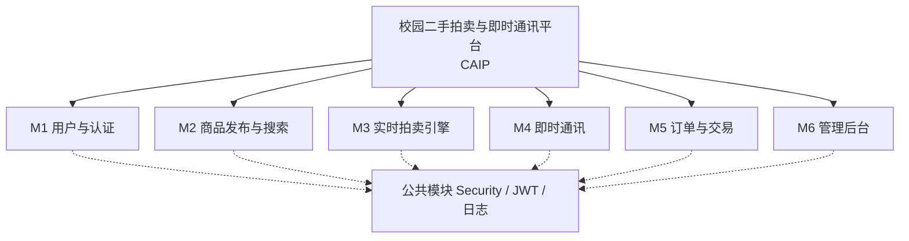
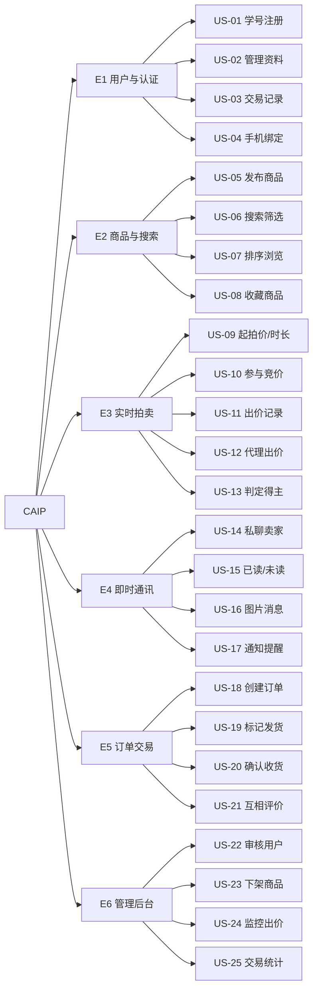
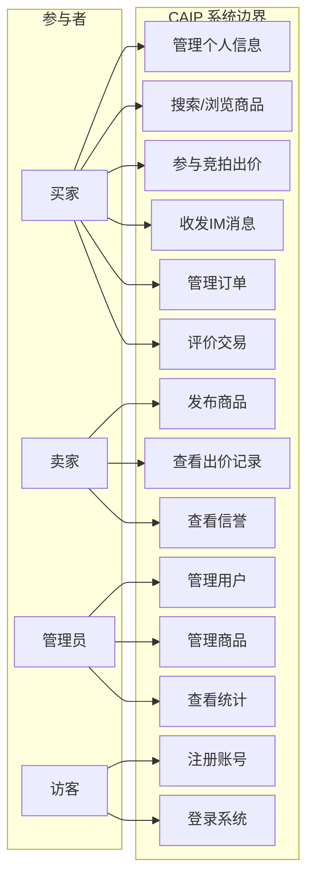
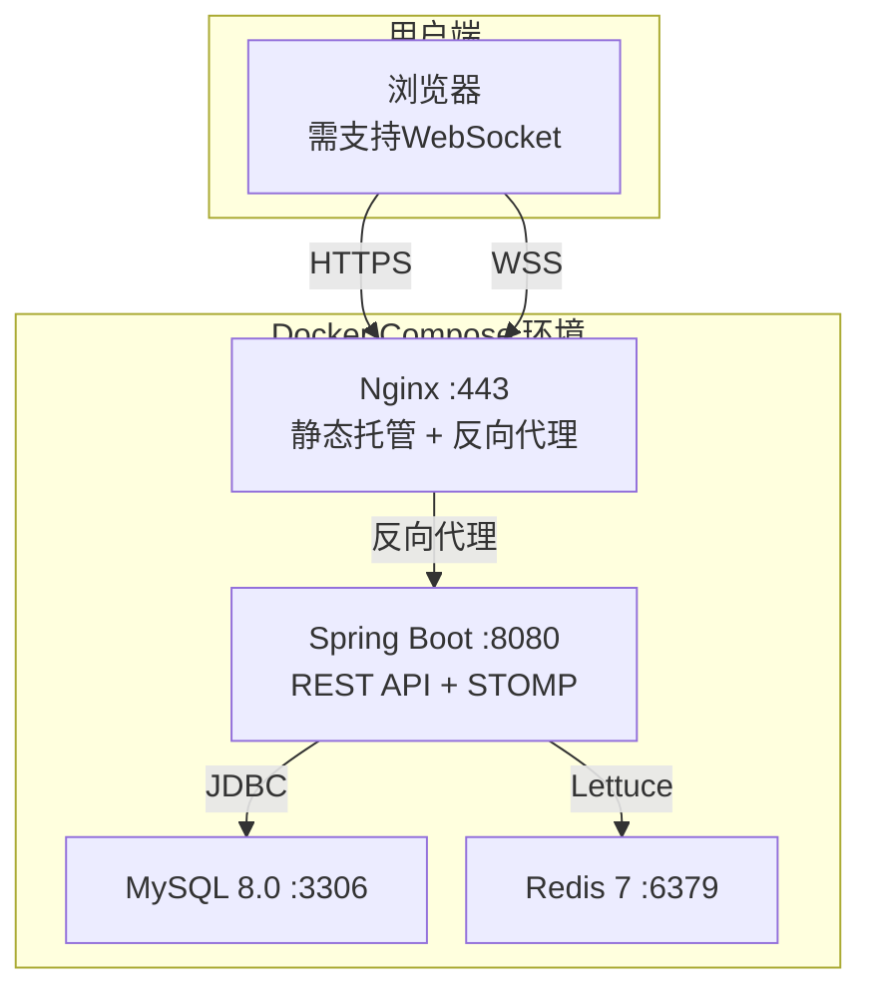
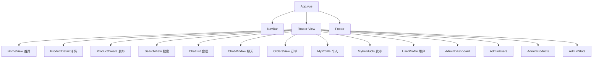
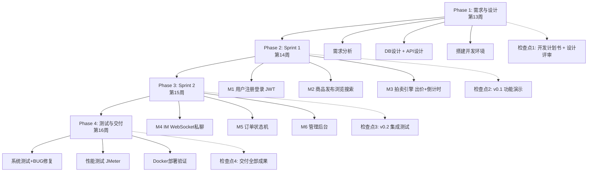
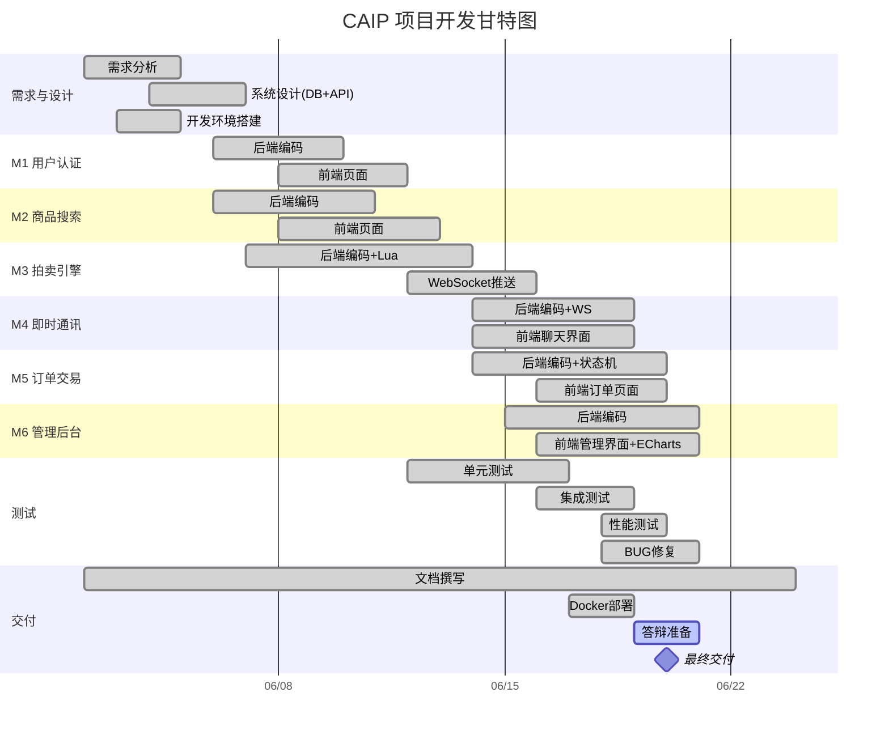
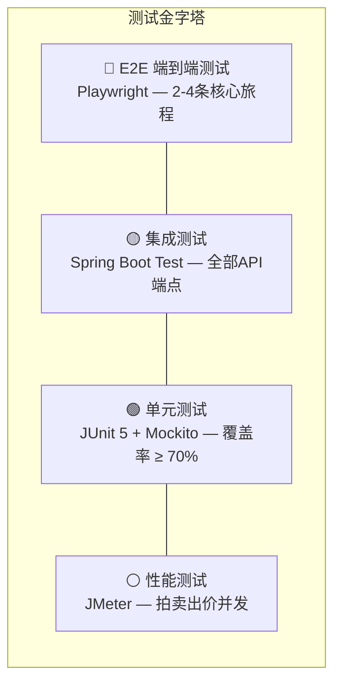
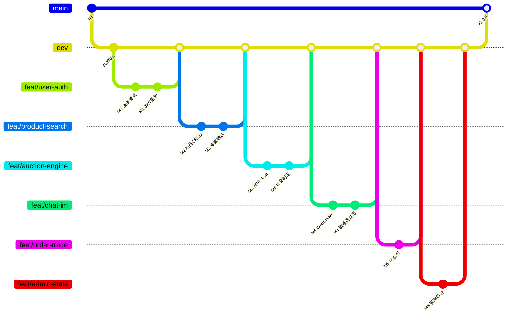

<!-- Cover Page -->
<div style="text-align: center; padding-top: 120px;">

<br>
<br>
<br>
<br>

**<span style="font-size: 1.6em;">软件工程实验</span>**

<br>

**<span style="font-size: 2em;">开发计划书</span>**

<br>
<br>

**文件编号：CAIP-PLAN-001**

**项目名称：校园二手拍卖与即时通讯平台**
**（Campus Auction & IM Platform, CAIP）**

<br>

| | |
|:--|:--|
| **作　　者** | 顾思豪、刘子彦、欧阳熠、段睿智、罗圣杰、罗涵 |
| **部　　门** | 第9组 |
| **日　　期** | 2026年6月18日 |
| **版　　本** | v1.2 |

<br>
<br>

</div>

<div style="page-break-after: always;"></div>

# 校园二手拍卖与即时通讯平台 —— 开发计划书

## 改版履历

| 版本序号 | 作者名称/作成日期 | 改版的主要内容 |
|:--:|---------|---------|
| v1.0 | 顾思豪 / 2026-06-01 | 初稿创建 |
| v1.1 | 全组 / 2026-06-05 | 补充需求规格、技术方案、RACI矩阵、风险矩阵等内容 |
| v1.2 | 全组 / 2026-06-18 | 更新分工明细与文档图表 |

---

## 目录

1. [项目概要](#1项目概要)
2. [体制](#2体制)
3. [需求规格说明](#3需求规格说明)
4. [技术方案](#4技术方案)
5. [整体作业计划](#5整体作业计划)
6. [进度管理](#6进度管理)
7. [质量计划](#7质量计划)
8. [交付物品](#8交付物品)
9. [作业环境](#9作业环境)
10. [技术学习计划](#10技术学习计划)
11. [风险管理](#11风险管理)
12. [配置管理计划](#12配置管理计划)
13. [对委托方的要求事项](#13对委托方的要求事项)

---

## 1.项目概要

### 1.1 项目名

**校园二手拍卖与即时通讯平台**（Campus Auction & IM Platform, CAIP）

### 1.2 开发目的和背景

#### 背景
随着高校学生消费能力提升和物品更新换代加快，校园内二手交易需求日益旺盛。然而，现有二手交易平台（如闲鱼、转转）存在以下问题：

1. **缺乏校园地理属性**：交易双方往往相隔较远，物流成本高、信任度低；
2. **缺乏即时沟通工具**：买卖双方通常需要添加微信或QQ，隐私泄露风险高；
3. **交易方式单一**：缺少拍卖等趣味性和竞争性交易模式；
4. **信息混乱**：校内QQ群、微信群交易消息刷屏严重，商品信息难以检索和追溯；
5. **交易无保障**：先款后货存在信任风险，缺乏信誉评价体系。

#### 目的
构建一个面向高校校园的二手拍卖与即时通讯一体化平台：
- 以**实时拍卖**为核心交易模式，解决价格发现问题，增加交易趣味性
- 以**内置即时通讯**替代第三方通信工具，保护用户隐私
- 以**校园身份认证**（学号/教工号）构建可信交易环境
- 以**信誉评价体系**降低交易风险

同时，该项目在软件工程实验课程框架下实施，作为六人小组协作完成的完整软件开发实践，完整实践需求分析→系统设计→编码实现→测试交付的全流程。

#### 可行性
- **技术可行性**：Spring Boot + Vue 3 + WebSocket + MySQL + Redis，均为成熟技术栈
- **经济可行性**：开源技术栈无需付费授权，部署于学校服务器或云主机
- **时间可行性**：6人团队4周开发，功能范围可控

### 1.3 功能概要

本平台包含**6大功能模块**：

> **图1-1 功能模块层次图**



| 模块编号 | 模块名称 | 功能概要 | 负责成员 |
|:--:|---------|---------|:--:|
| M1 | 用户与认证 | 注册登录（学号/工号认证）、JWT鉴权、个人信息管理、角色权限管理 | 顾思豪 |
| M2 | 商品发布与搜索 | 一口价商品和拍卖商品发布、多图+分类标签、关键词全文搜索、多条件筛选、收藏 | 刘子彦 |
| M3 | 实时拍卖引擎 | 英式升价拍卖、出价记录实时推送、倒计时自动成交、异常出价监控 | 段睿智 |
| M4 | 即时通讯(IM) | 买卖双方一对一私聊、支持文字+图片、消息已读/未读、聊天记录持久化 | 罗圣杰 |
| M5 | 订单与交易 | 订单生成、模拟支付、确认收货、交易评价、订单状态机 | 罗涵 |
| M6 | 管理后台与统计 | 用户管理、商品审核、数据统计看板、拍卖监管 | 欧阳熠 |

**系统整体业务流程：**

用户注册(学号认证) → 发布商品(一口价或拍卖) → 买家浏览/搜索商品
→ 参与拍卖(实时出价)或直接购买 → 拍卖结束自动成交
→ 内置IM私聊沟通细节 → 下单模拟支付 → 发货/收货 → 互相评价
→ 管理后台审核与数据统计

**扩展功能（视进度）：**
- 校内摊位地图：基于LBS展示各宿舍楼/教学楼的"跳蚤摊位"
- 热门商品推荐：根据浏览历史推荐相似商品

### 1.4 作业范围

**本团队承担范围**：全部6个模块的需求分析、系统设计、编码实现、测试、部署。

作业范围覆盖软件开发生命周期全流程：
1. 需求分析与功能设计
2. 系统架构设计与接口设计
3. 数据库设计与实现
4. 前端用户端和管理端页面开发
5. 后端API服务开发（含认证、商品、订单、拍卖、消息模块）
6. WebSocket即时通讯服务开发
7. 功能测试、接口测试与性能测试
8. 文档撰写与答辩准备

**不涉及的部分**：
- 真实支付对接（使用模拟支付）
- 短信/邮件服务（使用站内通知代替）
- 移动端App（仅Web端，移动端浏览器适配）
- 真实校园卡认证接口（如无法提供模拟API，则使用学号+密码验证替代）

### 1.5 作业形态

新开发项目。本项目为从零开始构建的全新系统。

采用**敏捷开发模型**，通过四个迭代阶段逐步完成，每个阶段对应一次实验课程检查节点。

### 1.6 设计输入与设计输出

**设计输入：**
1. 软件工程实验课程要求（`docs/02 software-实验总要求-2026.pdf`）
2. 软件工程文档模板（开发计划书、功能设计说明书、详细设计说明书、测试报告书模板）
3. 课程实验检查节点要求（4次实验课）
4. 高校二手交易场景需求（组内成员日常经验 + 校园调研）
5. 参考平台：闲鱼（商品发布）、微拍堂（拍卖模式）、微信（IM体验）

**设计输出：**
1. 开发计划书（本文档）
2. 功能和概要设计说明书（含接口规范、系统架构图、数据库设计）
3. 测试设计及结果报告书
4. 项目总结报告书 + PPT
5. 完整可运行的源代码
6. Docker部署配置

### 1.7 开发规模

| 模块 | 原始代码规模预估(KL) | 开发方式 |
|------|:--:|---------|
| M1 用户与认证 | 1.5 | 新开发 |
| M2 商品发布与搜索 | 2.0 | 新开发 |
| M3 实时拍卖引擎 | 2.5 | 新开发 |
| M4 即时通讯(IM) | 2.0 | 新开发 |
| M5 订单与交易 | 1.5 | 新开发 |
| M6 管理后台与统计 | 1.5 | 新开发 |
| 公共模块(common) | 1.0 | 新开发 |
| **合计** | **12.0** | |

> 说明：以上为后端Java代码预估，前端Vue3代码约10KL。总计约22KL。

---

## 2.体制

### 2.1 开发体制

| 职能 | 姓名 | 担当业务（具体化） |
|------|------|---------|
| 项目责任人 | 对应的助教 | 课程指导、进度检查、评分 |
| **项目组长(PM)** | **顾思豪** | 项目协调、文档整合、M1用户认证模块（前后端）、代码审查 |
| 核心开发 | 刘子彦 | M2商品发布与搜索模块（前后端）+ Redis缓存 |
| 开发人员 | 欧阳熠 | M6管理后台与统计模块 + 前端架构 + 部署运维 + 展示PPT |
| 开发人员 | 段睿智 | M3实时拍卖引擎（后端+WebSocket） |
| 开发人员 | 罗圣杰 | M4即时通讯模块（WebSocket+后端+前端） |
| 开发人员 | 罗涵 | M5订单与交易模块（前后端）+ 数据库设计 |

### 2.2 RACI职责矩阵

| 任务/活动 | 顾思豪 | 刘子彦 | 段睿智 | 罗圣杰 | 罗涵 | 欧阳熠 |
|-----------|:--:|:--:|:--:|:--:|:--:|:--:|
| 项目计划与协调 | **A/R** | I | I | I | I | I |
| M1 用户与认证 | **A/R** | - | - | - | - | - |
| M2 商品与搜索 | - | **A/R** | - | - | - | - |
| M3 拍卖引擎 | - | - | **A/R** | C | - | - |
| M4 即时通讯 | - | - | C | **A/R** | - | - |
| M5 订单交易 | - | - | - | - | **A/R** | - |
| M6 管理后台 | - | C | - | - | - | **A/R** |
| 前端架构 | C | C | - | - | - | **A/R** |
| 数据库设计 | C | C | C | C | **A/R** | C |
| API接口规范 | **A/R** | C | C | C | C | C |
| 单元测试 | C | **A/R** | **A/R** | **A/R** | **A/R** | **A/R** |
| 集成测试 | **A/R** | C | C | C | C | C |
| 文档整合 | **A/R** | C | C | C | C | C |
| Docker部署 | I | - | - | - | - | **A/R** |

> **R**=Responsible(执行), **A**=Accountable(负责), **C**=Consulted(咨询), **I**=Informed(知会)

### 2.3 委托方联络窗口

| 职能 | 姓名 | 联系办法 |
|------|------|---------|
| 课程教师 | （教师姓名） | 按课程公布方式 |
| 辅导教师 | 张一凡 | 19591126800 |
| 学生联络人(组长) | 顾思豪 | 2092313428@qq.com |

---

## 3.需求规格说明

### 3.1 用户角色定义

| 角色 | 描述 | 核心需求 |
|------|------|---------|
| **普通用户（买家/卖家）** | 在校学生/教职工，平台主要使用者 | 浏览商品、发布商品、参与竞拍、IM沟通、订单管理 |
| **管理员** | 平台运营者 | 用户审核、商品审核、拍卖监管、数据统计、举报处理 |

### 3.2 用户故事地图

> **图3-1 用户故事地图**



### 3.3 用例模型

> **图3-2 系统用例图**



**参与者：** 买家、卖家、管理员

| 用例编号 | 用例名称 | 参与角色 | 简要描述 |
|:--:|---------|:--:|---------|
| UC-01 | 注册账号 | 买家、卖家 | 学号+密码+邮箱注册，平台验证身份 |
| UC-02 | 登录系统 | 全部 | 账号密码登录，获取JWT Token |
| UC-03 | 管理个人信息 | 买家、卖家 | 编辑昵称、头像、简介、绑定手机 |
| UC-04 | 发布商品 | 卖家 | 发布一口价或拍卖商品，含图文描述 |
| UC-05 | 搜索/浏览商品 | 买家 | 关键词搜索 + 分类筛选 + 排序 |
| UC-06 | 参与竞拍出价 | 买家 | 对拍卖商品出价，须高于当前最高价 |
| UC-07 | 查看出价记录 | 买家、卖家 | 查看某商品的完整出价历史 |
| UC-08 | 发送/接收IM消息 | 买家、卖家 | 一对一私聊，文字+图片 |
| UC-09 | 管理订单 | 买家、卖家 | 查看订单、支付、发货、收货 |
| UC-10 | 评价交易 | 买家、卖家 | 交易完成后互相评分（1-5星+文字） |
| UC-11 | 查看信誉评分 | 买家、卖家 | 查看任意用户的信誉与评价记录 |
| UC-12 | 管理用户 | 管理员 | 身份审核、封禁/解封用户 |
| UC-13 | 管理商品 | 管理员 | 下架违规商品、分类标签管理 |
| UC-14 | 查看统计看板 | 管理员 | 活跃度、交易额、成交率等数据 |

### 3.4 功能性需求列表

| 编号 | 需求描述 | 优先级 | 模块 |
|:--:|---------|:--:|:--:|
| FR-01 | 用户可通过学号+邮箱注册账号 | 高 | M1 |
| FR-02 | 用户可通过账号密码登录，获取JWT Token | 高 | M1 |
| FR-03 | 用户可编辑个人资料（昵称、头像、简介） | 中 | M1 |
| FR-04 | 用户可发布一口价商品和拍卖商品（标题、描述、图片、分类、价格/起拍价、拍卖时长） | 高 | M2 |
| FR-05 | 用户可通过关键词搜索商品 | 高 | M2 |
| FR-06 | 用户可按分类、价格区间、发布时间、校区筛选商品 | 中 | M2 |
| FR-07 | 用户可收藏/取消收藏商品 | 低 | M2 |
| FR-08 | 买家可对拍卖商品出价（出价须高于当前最高价） | 高 | M3 |
| FR-09 | 系统实时推送出价更新给所有围观用户 | 高 | M3 |
| FR-10 | 拍卖截止时间到达自动判定得主，生成成交记录 | 高 | M3 |
| FR-11 | 出价并发场景下保证"先到先得"，不丢失出价 | 高 | M3 |
| FR-12 | 买卖双方可通过IM进行一对一私聊（文字+图片） | 高 | M4 |
| FR-13 | IM消息显示已读/未读状态 | 中 | M4 |
| FR-14 | 新消息通过站内通知提醒 | 中 | M4 |
| FR-15 | 成交后自动生成订单 | 高 | M5 |
| FR-16 | 买家可模拟支付，卖家可标记发货 | 中 | M5 |
| FR-17 | 买家确认收货后订单完成，双方可互相评价 | 高 | M5 |
| FR-18 | 交易完成后双方可互相评分（1-5星+文字评价） | 高 | M6 |
| FR-19 | 用户主页展示信誉评分、成交数、好评率 | 中 | M6 |
| FR-20 | 管理员可审核用户身份、封禁违规用户 | 中 | M6 |
| FR-21 | 管理员可下架违规商品、管理分类标签 | 中 | M6 |
| FR-22 | 管理员可查看平台数据统计（活跃度、交易额、成交率） | 中 | M6 |

### 3.5 非功能性需求列表

| 编号 | 类别 | 需求描述 |
|:--:|------|---------|
| NFR-01 | 性能 | 核心API响应时间P50 < 200ms |
| NFR-02 | 性能 | 拍卖出价WebSocket推送延迟 < 500ms |
| NFR-03 | 性能 | 支持至少100用户同时参与同一场拍卖 |
| NFR-04 | 安全 | 密码BCrypt加密存储 |
| NFR-05 | 安全 | JWT Token认证，敏感接口校验身份 |
| NFR-06 | 安全 | 用户输入校验防XSS/SQL注入 |
| NFR-07 | 安全 | 文件上传限制（图片≤5MB，jpg/png/gif） |
| NFR-08 | 安全 | IM聊天内容敏感词过滤 |
| NFR-09 | 可用性 | 前端响应式设计，移动端浏览器可用 |
| NFR-10 | 可维护性 | 后端单元测试覆盖率 ≥ 70% |
| NFR-11 | 兼容性 | 支持Chrome 120+、Edge 120+、Firefox最新版 |

---

## 4.技术方案

### 4.1 技术选型总览

| 层级 | 技术 | 说明 |
|------|------|------|
| **前端框架** | Vue 3 + Vite + TypeScript | 组合式API，类型安全，编译时构建 |
| **UI组件库** | Element Plus | Vue 3企业级组件库，生态成熟 |
| **状态管理** | Pinia | Vue 3官方推荐状态管理 |
| **后端框架** | Spring Boot 3.2 + JDK 17 | Java生态主流框架，内嵌WebSocket支持 |
| **ORM** | MyBatis-Plus 3.5 | Lambda查询，分页插件，代码生成器 |
| **数据库** | MySQL 8.0 | 成熟稳定，全文索引，主从复制 |
| **缓存** | Redis 7 | 拍卖出价缓存、Session共享、排行榜 |
| **实时通信** | WebSocket (Spring STOMP) | Spring原生支持，基于STOMP协议 |
| **认证鉴权** | Spring Security + JWT | 无状态认证，RBAC细粒度授权 |
| **API文档** | SpringDoc OpenAPI 2.x | 自动生成Swagger接口文档 |
| **测试框架** | JUnit 5 + Mockito + Testcontainers | 单元测试 + 集成测试(真实DB容器) |
| **数据库迁移** | Flyway | 数据库版本管理 |
| **容器化** | Docker + Docker Compose | 一键部署 |
| **版本管理** | Git + GitHub/Gitee | 分支管理，代码审查 |

### 4.2 系统架构（C4容器图）

> **图4-1 系统架构容器图**



系统采用前后端分离架构：
- **用户（浏览器）** 通过HTTPS访问Vue 3前端应用，通过WSS与WebSocket服务器建立长连接
- **Vue 3前端（Nginx静态托管）** 提供商品浏览/搜索、拍卖出价界面、IM聊天窗口、订单管理界面等
- **Spring Boot后端服务** 按6个模块划分：用户(M1)、商品(M2)、拍卖(M3)、IM(M4)、订单(M5)、管理后台(M6)，以及公共模块(认证/异常/工具)
- **WebSocket服务（Spring Boot内嵌STOMP）** 处理拍卖出价实时推送和IM消息实时推送
- **MySQL 8.0** 存储业务数据、消息记录、用户信息
- **Redis 7** 处理拍卖出价缓存、Session共享

外部系统依赖：无（本系统为独立部署，不依赖第三方API）。

### 4.3 前端架构

> **图4-2 前端组件树**



**路由设计：**
| 路由 | 页面 | 说明 |
|------|------|------|
| `/` | 首页 | 商品Feed流 + 热门拍卖 |
| `/login` | 登录页 | 账号密码登录 |
| `/register` | 注册页 | 学号注册 |
| `/product/:id` | 商品详情 | 含拍卖区 + 出价记录 |
| `/product/create` | 发布商品 | 选择一口价/拍卖模式 |
| `/search?q=&cat=&sort=` | 搜索结果 | 多条件筛选 |
| `/chat` | IM消息列表 | 所有会话 |
| `/chat/:userId` | IM聊天窗口 | 与某用户的私聊 |
| `/user/:id` | 用户主页 | 信誉+评价+交易记录 |
| `/user/profile` | 个人资料 | 编辑个人信息 |
| `/orders` | 我的订单 | 订单列表+状态筛选 |
| `/admin` | 管理后台 | 仪表盘首页 |
| `/admin/users` | 用户管理 | 审核+封禁 |
| `/admin/products` | 商品管理 | 审核+下架 |
| `/admin/stats` | 数据统计 | 图表看板 |

### 4.4 数据库设计概要

**核心表（16张）：**

**用户域：**
- `users` — 用户表 (id, student_id, username, password_hash, email, phone, avatar, role, reputation_score, status, created_at, updated_at)

**商品域：**
- `products` — 商品表 (id, seller_id, title, description, category_id, type[sale/auction], start_price, fixed_price, current_price, status, auction_start, auction_end, winner_id, view_count, created_at)
- `product_images` — 商品图片 (id, product_id, image_url, sort_order)
- `product_favorites` — 收藏 (id, user_id, product_id, created_at)
- `categories` — 分类 (id, name, icon, parent_id)

**拍卖域：**
- `bids` — 出价记录 (id, product_id, user_id, bid_amount, bid_time, is_auto)

**IM域：**
- `conversations` — 会话 (id, user1_id, user2_id, product_id, last_message_at, created_at)
- `messages` — 消息 (id, conversation_id, sender_id, content, content_type[text/image], is_read, created_at)

**订单域：**
- `orders` — 订单 (id, product_id, buyer_id, seller_id, amount, status[pending/paid/shipped/completed/cancelled], created_at, paid_at, shipped_at, completed_at)

**评价域：**
- `reviews` — 评价 (id, order_id, reviewer_id, target_user_id, rating[1-5], content, created_at)

**通知域：**
- `notifications` — 通知 (id, user_id, type, title, content, is_read, related_url, created_at)

**管理域：**
- `reports` — 举报 (id, reporter_id, target_type, target_id, reason, status, created_at)
- `sensitive_words` — 敏感词 (id, word, created_at)

### 4.5 API设计概要

统一前缀：`/api/v1`

| 模块 | 端点 | 方法 | 说明 |
|------|------|:--:|------|
| 认证 | `/api/v1/auth/register` | POST | 注册 |
| 认证 | `/api/v1/auth/login` | POST | 登录，返回JWT |
| 用户 | `/api/v1/users/me` | GET/PUT | 查看/编辑个人信息 |
| 用户 | `/api/v1/users/{id}` | GET | 用户主页 |
| 商品 | `/api/v1/products` | GET/POST | 商品列表/发布 |
| 商品 | `/api/v1/products/{id}` | GET | 商品详情 |
| 商品 | `/api/v1/products/search` | GET | 搜索(q, cat, min, max, sort) |
| 商品 | `/api/v1/products/{id}/favorite` | POST | 收藏/取消 |
| 拍卖 | `/api/v1/products/{id}/bids` | GET/POST | 出价记录/出价 |
| 拍卖 | `/ws/auction/{productId}` | WS(订阅) | 拍卖实时推送 |
| IM | `/api/v1/conversations` | GET/POST | 会话列表/创建 |
| IM | `/api/v1/conversations/{id}/messages` | GET/POST | 消息列表/发送 |
| IM | `/ws/chat` | WS(双向) | IM实时通信 |
| 订单 | `/api/v1/orders` | GET/POST | 订单列表/创建 |
| 订单 | `/api/v1/orders/{id}/pay` | POST | 模拟支付 |
| 订单 | `/api/v1/orders/{id}/ship` | POST | 标记发货 |
| 订单 | `/api/v1/orders/{id}/confirm` | POST | 确认收货 |
| 评价 | `/api/v1/reviews` | GET/POST | 评价列表/发表评价 |
| 管理 | `/api/v1/admin/users` | GET/PUT | 用户管理(管理员) |
| 管理 | `/api/v1/admin/products` | GET/PUT | 商品管理(管理员) |
| 管理 | `/api/v1/admin/stats` | GET | 统计数据(管理员) |
| 通知 | `/api/v1/notifications` | GET | 通知列表 |
| 通知 | `/api/v1/notifications/{id}/read` | PUT | 标记已读 |

> API文档通过SpringDoc OpenAPI自动生成，访问 `http://localhost:8080/swagger-ui.html`

---

## 5.整体作业计划

### 5.1 工数预测

**预测根据：**
1. 项目周期4周（约1个月），按每月20个工作日计算，6人团队总可用工数为6.00人月
2. 开发模型采用敏捷迭代，前端、后端、WebSocket可并行推进
3. 组员均具有基本编程能力，WebSocket和拍卖逻辑需投入学习时间（已在技术学习计划中安排）
4. 风险预留：拍卖倒计时和并发出价逻辑复杂，预留约0.3人月用于调试和压力测试

| 工程阶段 | 预计工数(人日) | 预计工数(人月) | 说明 |
|---------|:--:|:--:|------|
| 需求分析与设计 | 18 | 0.90 | 需求确认、接口设计、数据库设计、页面原型 |
| 数据准备 | 8 | 0.40 | 模拟商品数据、用户数据、分类标签 |
| 编码实现 | 50 | 2.50 | 前端、后端API、WebSocket、拍卖引擎 |
| 测试 | 18 | 0.90 | 单元测试、集成测试、并发测试、系统测试 |
| 文档撰写 | 16 | 0.80 | 四项文档 + 项目总结PPT |
| 答辩准备 | 10 | 0.50 | 演示用例准备、彩排 |
| **合计** | **120** | **6.00** | 6人 × 1个月，工数利用率100% |

### 5.2 开发模型

采用**敏捷开发模型**。4个迭代阶段，每个阶段对应一次实验课程检查节点，每个阶段末产出可演示的增量版本。

**开发阶段划分：**

> **图5-0 开发阶段流程图**



### 5.3 日程计划

| 周次 | 工程/阶段 | 里程碑 | 详细任务 |
|:--:|---------|---------|---------|
| **第1周** | 需求分析 & 系统设计 | 需求评审通过<br>设计评审通过 | 用户访谈，撰写需求规格书；数据库设计，API设计；搭建开发环境 |
| **第2周** | Sprint1 核心功能开发 | 中间版本v0.1<br>功能演示 | M1用户注册登录、M2商品发布浏览、M3拍卖出价核心逻辑 |
| **第3周** | Sprint2 完善功能 & IM | 6.24中间版本v0.2<br>6.26集成测试 | M4即时通讯模块；M5订单生成；M6管理后台基本功能 |
| **第4周** | 测试 & 交付 | 7.1交付判定会议<br>7.3最终交付 | 系统测试、BUG修复；编写文档；交付全部成果物 |

**详细甘特图：**

> **图5-1 开发甘特图**



> 图例：done = 已完成 | active = 进行中 | milestone = 里程碑

---

## 6.进度管理

### 6.1 进度报告

| 项目 | 内容 |
|------|------|
| **报告方式** | QQ群日常沟通 + GitHub Issues任务追踪 + 每周实验课正式汇报 |
| **报告频率** | 每日站会（线上文字，每人一句：昨天做了什么/今天做什么/有无阻塞）<br>每周1次正式进度汇报（实验课上） |
| **报告内容** | 本周完成情况、下周计划、当前阻塞问题、风险更新 |
| **进度追踪工具** | GitHub Projects看板（To Do / In Progress / Done）<br>或 Trello 看板 |
| **作业时间登录** | 使用GitHub commit记录作为作业时间的主要依据 |

### 6.2 技术讨论

| 项目 | 内容 |
|------|------|
| **沟通平台** | QQ群（日常文字沟通）+ 腾讯会议（重要讨论/代码审查） |
| **讨论频率** | 按需发起，每周至少1次腾讯会议（建议每周日晚30min） |
| **会议记录** | 每次腾讯会议后组长记录要点，存档至 `docs/会议纪要/` |
| **技术决策** | 架构决策、接口变更等重大事项需组内讨论达成共识后记录 |

---

## 7.质量计划

### 7.1 质量目标

| 质量指标 | 目标值 | 测量方式 |
|---------|:--:|---------|
| 后端单元测试覆盖率 | ≥ 70% | JaCoCo |
| 核心API集成测试通过率 | 100% | JUnit 5 + Testcontainers |
| P0/P1级别Bug数（交付时） | 0 | 缺陷统计表 |
| 核心API响应时间 P50 | < 200ms | Locust/JMeter |
| 拍卖出价推送延迟 | < 500ms | 手动测试 + 日志时间戳分析 |
| 潜在BUG预测值 | 约15-20个（6个模块×3个/模块） | 按500行/缺陷行业均值估算 |
| 测试密度 | 约1.5个测试用例/功能点 | 22个功能需求 × 1.5 = 33个测试用例 |

### 7.2 工程移行基准

| 工程阶段 | 移行判定基准 |
|---------|-------------|
| 需求分析→设计 | 需求评审通过，用户故事全部确认<br>数据库ER图审查完成 |
| 设计→编码 | API接口定义完成（SpringDoc Swagger文档可访问）<br>数据库DDL通过Flyway执行成功 |
| 编码→测试 | 各模块功能可独立运行<br>核心流程（注册→发布→浏览→出价→成交）可走通 |
| 测试→交付 | 单元测试覆盖率 ≥ 70%<br>集成测试全部通过<br>无P0/P1级别Bug<br>Docker Compose可一键部署 |

### 7.3 代码审查计划

- 每个PR/MR必须经过至少1位其他成员审查
- 审查关注点：逻辑正确性、代码规范（PEP8）、SQL注入防护、XSS防护、硬编码密钥
- 审查工具：GitHub/Gitee Pull Request Review功能
- 合并策略：Squash Merge保持主干干净

### 7.4 测试策略

**测试金字塔模型：**

> **图7-1 测试金字塔**



- **单元测试**：每个Service方法，Mock数据库和Redis
- **集成测试**：每个API端点，Testcontainers启动真实MySQL容器
- **E2E测试**：Playwright — 注册→浏览商品→出价→成交→IM沟通→评价
- **性能测试**：JMeter，重点测试拍卖出价接口并发

---

## 8.交付物品

### 8.1 交付物品一览

| 编号 | 成果物名称及版本 | 交付方式及媒体 | 预定交货期 | 使用语言 |
|:--:|---------|---------|:--:|------|
| 1 | 开发计划书 v1.0 | 电子版（PDF/DOCX） | 第13周周五 | 中文 |
| 2 | 功能和概要设计说明书 v1.0 | 电子版（PDF/DOCX） | 第14周周五 | 中文 |
| 3 | 测试设计及结果报告书 v1.0 | 电子版（PDF/DOCX） | 第15周周五 | 中文 |
| 4 | 项目总结报告书 v1.0 | 电子版（PDF/DOCX） | 第16周课后 | 中文 |
| 5 | 项目总结PPT | 电子版（PPTX） | 第16周课后 | 中文 |
| 6 | 源代码（前端+后端）v1.0 | GitHub/Gitee仓库 | 第16周课后 | Java, TypeScript |
| 7 | 数据库脚本及数据字典 | SQL文件 | 第16周课后 | SQL |
| 8 | Docker部署配置 | GitHub/Gitee仓库 | 第16周课后 | YAML/Dockerfile |
| 9 | Excel成员名单 | 压缩包内 | 第16周课后 | XLSX |

**最终提交格式**：所有文件放入一个压缩包，命名为"9组.zip"，代码和文档分目录，不含可执行程序。

---

## 9.作业环境

### 9.1 开发环境

| 类别 | 配置 |
|------|------|
| **IDE-后端** | IntelliJ IDEA / VS Code + Java插件 |
| **IDE-前端** | VS Code + Volar + ESLint + Prettier |
| **JDK** | 17 |
| **Node.js** | 18+ |
| **构建工具** | Maven 3.8+ (后端) / Vite (前端) |
| **数据库** | MySQL 8.0（Docker容器或本地实例） |
| **缓存** | Redis 7（Docker容器或本地实例） |
| **版本管理** | Git + GitHub/Gitee |
| **API测试** | SpringDoc Swagger UI（自动生成）/ Postman |
| **OS** | Windows 11 / macOS（开发），Ubuntu 20.04（服务器） |

### 9.2 运行环境

| 类别 | 配置 |
|------|------|
| **服务器** | Docker Engine 24+ / 云主机（建议2核4G以上） |
| **数据库** | MySQL 8.0（Docker容器） |
| **缓存** | Redis 7（Docker容器） |
| **反向代理** | Nginx（Docker容器） |
| **OS** | Linux（Ubuntu 18+ 或 CentOS 7+） |
| **浏览器** | Chrome 120+ / Edge 120+ |

### 9.3 测试环境

| 类别 | 配置 |
|------|------|
| **单元测试** | JUnit 5 + Mockito（无需外部环境） |
| **集成测试** | Testcontainers（自动启动临时MySQL容器） |
| **性能测试** | JMeter 5.x（本地运行，连接测试环境） |
| **E2E测试** | Playwright（无头浏览器） |
| **移动端测试** | Android/iOS手机浏览器（可选） |

---

## 10.技术学习计划

| 担当者 | 必需的技术/知识 | 学习方法 | 学习时间 | OUTPUT |
|--------|-------------|---------|:--:|------|
| 所有成员 | Git协作流程（分支、PR、Code Review） | 观看视频+小组练习 | 第1周前2天 | 能独立完成分支操作和PR |
| 顾思豪、刘子彦 | Vue 3 + Element Plus | 官方教程+项目实践 | 贯穿前2周 | 完成前端框架搭建 |
| 段睿智、罗圣杰 | Spring Boot WebSocket + STOMP | 文档学习+代码示例 | 贯穿前2周 | 完成WebSocket服务搭建 |
| 段睿智 | Redis基础操作 | 官方文档+实战 | 第2周 | Redis缓存读写Demo |
| 罗涵 | PostgreSQL SQL优化 | 博客+实验 | 第1周 | 数据库性能无明显问题 |
| 欧阳熠 | Docker Compose | 官方文档+现成模板 | 第3周 | docker-compose.yml |
| 欧阳熠 | 敏捷管理工具（Trello/GitHub Projects） | 在线教程 | 第1周 | 项目看板正常使用 |
| 全员 | JUnit 5 + Mockito | 现有知识+查漏补缺 | 第3周 | 各自模块单元测试通过 |
| 组长 | JMeter | 官方文档+教程 | 第3周末 | 压测脚本 |

---

## 11.风险管理

### 11.1 风险识别与应对

| 编号 | 风险描述 | 可能性 | 影响范围及程度 | 可能的预防方法 | 风险发生时预计采取的对策 |
|:--:|---------|:--:|--------------|---------|---------|
| R1 | **WebSocket实时推送实现困难**：拍卖出价并发场景下消息丢失或延迟高 | 中 | 高：拍卖模块核心体验，影响M3和M4 | 早期搭建WebSocket原型验证可行性；使用Spring STOMP简化开发 | 降低实时性要求（手动刷新作为降级方案）；组内技术讨论+请教助教 |
| R2 | **MySQL全文搜索中文分词效果不佳** | 中 | 中：搜索体验不好但可降级为LIKE查询 | 提前测试MySQL全文索引ngram分词器中文效果 | 降级为LIKE模糊搜索 + 分类筛选 |
| R3 | **成员进度不一致**：某个模块延期阻塞依赖模块 | 高 | 高：影响整体进度，可能导致无法按时交付 | 每日站会暴露问题；模块并行开发减少依赖；关键路径模块提前启动 | 组长协调资源倾斜；必要时缩小延期模块的功能范围 |
| R4 | **拍卖并发冲突导致数据不一致**：同一时刻多用户出价，价格记录错乱 | 中 | 高：拍卖核心逻辑错误将严重影响评分 | 使用Redis Lua脚本原子操作出价；数据库行级锁防并发 | 增加出价冲突测试用例；压测验证 |
| R5 | **团队对Spring WebSocket/STOMP不熟悉**：学习成本高，开发效率低 | 中 | 中：M3和M4开发效率下降 | 提前在第1-2周安排WebSocket学习；准备Demo参考代码 | 寻求助教帮助；参考开源Spring STOMP项目 |
| R6 | **时间不足**：4周内完成6个模块+4份文档+测试，工作量可能超预期 | 中 | 高：整体交付质量下降 | 严格按MVP优先级开发（高优先级功能先做）；文档与编码并行 | 优先保证核心流程可用（浏览→出价→成交→评价），次要功能标记为"后续版本" |
| R7 | **Docker环境配置问题**：不同成员本地环境不一致 | 低 | 中：开发效率和集成测试受影响 | 第1周统一Docker Compose配置；使用devcontainer标准化开发环境 | 提供详细的环境搭建文档；组内一对一协助 |

### 11.2 风险矩阵

```
            影响程度
            低        中        高
        ┌────────┬────────┬────────┐
  高    │        │        │  R3    │
        │        │        │        │
发生率   ├────────┼────────┼────────┤
  中    │        │  R2    │  R1    │
        │        │  R5    │  R4    │
        │        │        │  R6    │
        ├────────┼────────┼────────┤
  低    │        │  R7    │        │
        │        │        │        │
        └────────┴────────┴────────┘
```

- **红色区域（重点防范）**：R1, R4, R6 — 高影响+中概率
- **黄色区域（持续关注）**：R3 — 高影响+高概率
- **绿色区域（有应对方案即可）**：R2, R5, R7 — 中低影响

---

## 12.配置管理计划

### 12.1 Git仓库结构

```
campus-auction/
├── backend/                    # Spring Boot 后端项目
│   ├── src/main/java/com/ca/
│   │   ├── common/             # 公共模块(config/security/exception/util)
│   │   └── module/
│   │       ├── user/           # M1 用户认证
│   │       ├── product/        # M2 商品搜索
│   │       ├── auction/        # M3 拍卖引擎
│   │       ├── chat/           # M4 即时通讯
│   │       ├── order/          # M5 订单交易
│   │       └── admin/          # M6 管理后台
│   ├── src/main/resources/
│   │   ├── db/migration/       # Flyway数据库迁移
│   │   └── application.yml
│   ├── src/test/
│   └── pom.xml
├── frontend/                   # Vue 3 前端项目
│   └── src/
│       ├── views/              # 页面组件
│       ├── components/         # 公共组件
│       ├── stores/             # Pinia状态
│       ├── api/                # API封装
│       ├── router/             # 路由
│       └── utils/              # 工具
├── docs/                       # 文档
│   ├── 01-开发计划书/
│   ├── 02-设计说明书/
│   ├── 03-测试报告书/
│   ├── 04-项目总结报告/
│   └── 会议纪要/
├── deploy/                     # 部署配置
│   ├── docker-compose.yml
│   ├── nginx.conf
│   └── Dockerfile
├── .gitignore
├── CLAUDE.md
└── README.md
```

### 12.2 分支策略

采用简化Git Flow模型：

> **图12-1 Git分支策略**



```
main ← dev ← feat/<module-name>
```

| 分支 | 用途 | 保护规则 |
|------|------|---------|
| `main` | 最终交付版本 | 禁止直接push，仅从dev合并 |
| `dev` | 开发集成 | 禁止直接push，通过PR合并 |
| `feat/user-auth` | M1 用户认证 | 顾思豪维护 |
| `feat/product-search` | M2 商品搜索 | 刘子彦维护 |
| `feat/auction-engine` | M3 拍卖引擎 | 段睿智维护 |
| `feat/chat-im` | M4 即时通讯 | 罗圣杰维护 |
| `feat/order-trade` | M5 订单交易 | 罗涵维护 |
| `feat/admin-stats` | M6 管理后台 | 欧阳熠维护 |

### 12.3 提交信息规范

采用 **Conventional Commits** 格式：

```
<type>(<scope>): <description>

示例：
feat(auction): 实现拍卖出价WebSocket实时推送
fix(user): 修复JWT Token过期后登录状态丢失问题
docs(plan): 完善开发计划书风险管理章节
test(order): 添加订单状态流转单元测试
refactor(product): 优化商品搜索SQL查询性能
```

| Type | 含义 |
|------|------|
| `feat` | 新功能 |
| `fix` | Bug修复 |
| `docs` | 文档变更 |
| `refactor` | 代码重构 |
| `test` | 测试相关 |
| `style` | 代码格式调整 |
| `chore` | 构建/工具/依赖变更 |

### 12.4 软件产品版本标识

版本号格式：`v主版本.次版本.修订号`

- v0.1.0：第2周中间版本（核心功能）
- v0.2.0：第3周中间版本（完整功能+IM）
- v1.0.0：第4周最终交付版本

---

## 13.对委托方的要求事项

1. 请委托方在第1周周三前提供明确的用户角色定义（学生、教师、管理员）及数据安全要求
2. 请委托方在第1周周五前完成需求规格说明书的确认签字
3. 请委托方在第3周周四前提供测试账号（至少5个学生账号、1个教师账号、1个管理员账号）
4. 请委托方在第4周周二参与交付判定会议，并反馈验收意见
5. 如涉及真实校园卡认证接口，请委托方提供模拟API文档或测试环境

---

## 附录：第1次实验课检查准备清单

- [ ] 团队组建完成（6人），角色分工明确
- [ ] 项目选题确定（校园二手拍卖与即时通讯平台）
- [ ] GitHub/Gitee仓库创建，分支结构初始化
- [ ] 开发计划书完成（本文档）
- [ ] 各组员对各自负责模块有清晰认识
- [ ] 沟通平台就绪（QQ群 + 腾讯会议）
- [ ] 开发环境搭建开始（JDK/Node.js/PostgreSQL/Redis）

---

> **文档版本**: v1.1 | **编写日期**: 2026-06-05 | **组长**: 顾思豪
>
> 本文档按软件工程实验课程模板结构编写，满足 `docs/02 software-实验总要求-2026.pdf` 中对开发计划书的全部要求。
> 在组员初版（v1.0，顾思豪/2026-06-01）基础上补充了需求规格说明、技术方案、RACI矩阵、风险矩阵、配置管理计划等章节。
