<!-- Cover Page -->
<div style="text-align: center; padding-top: 120px;">

<br>
<br>
<br>
<br>

**<span style="font-size: 1.6em;">软件工程实验</span>**

<br>

**<span style="font-size: 2em;">需求与功能设计规格书</span>**

<br>
<br>

**文件编号：CAIP-FD-001**

**项目名称：校园二手拍卖与即时通讯平台**
**（Campus Auction & IM Platform, CAIP）**

<br>

| | |
|:--|:--|
| **作　　者** | 刘子彦（M2核心，贡献22%）、顾思豪（M1+PM，贡献21%）、欧阳熠（M6+前端+PPT，贡献16%）、段睿智（M3，贡献14%）、罗圣杰（M4，贡献14%）、罗涵（M5+DB，贡献13%） |
| **部　　门** | 第9组 |
| **日　　期** | 2026年6月9日 |
| **版　　本** | v1.0 |

<br>
<br>

</div>

<div style="page-break-after: always;"></div>

## 改版履历

| 版数 | 年月日 | 改版内容 | 承认 | 查阅 | 作成 | 备注 |
|:--:|------|---------|:--:|:--:|:--:|------|
| v1.0 | 2026-06-09 | 初稿作成 | — | — | 9组全员 | — |

---

<div style="page-break-after: always;"></div>

## 目录

[TOC]

<div style="page-break-after: always;"></div>

---

## 1. 前言

### 1.1 输入文档

| 编号 | 文档名称 | 版本 | 来源 |
|:--:|------|:--:|------|
| CAIP-PLAN-001 | 校园二手拍卖与即时通讯平台 开发计划书 | v1.1 | 9组 |
| 课程-001 | 软件工程实验总要求 | 2026 | 课程 |
| TEMPLATE-001 | 02_FD 功能和概要设计说明书 文档模板 | — | 课程模板 |

### 1.2 相关文档

| 编号 | 文档名称 | 说明 |
|:--:|------|------|
| CAIP-PLAN-001 | 开发计划书 | 项目规划、需求规格、技术选型 |
| CAIP-TEST-001 | 测试设计及结果报告书 | 测试策略与测试结果（后续交付） |
| CAIP-SUM-001 | 项目总结报告书 | 项目回顾与经验总结（后续交付） |

### 1.3 用语/术语定义

| 术语 | 定义 |
|------|------|
| CAIP（Campus Auction & IM Platform） | 本系统英文简称，校园二手拍卖与即时通讯平台 |
| 英式拍卖（English Auction） | 出价从低到高的升价拍卖，在截止时间内价高者得 |
| 一口价（Fixed Price） | 卖家设定固定价格，买家直接购买，无需竞价 |
| 流拍（Auction Expired） | 拍卖结束时无人出价，商品状态变为EXPIRED |
| STOMP | Simple Text Oriented Messaging Protocol，面向文本的消息协议，运行于WebSocket之上，支持发布订阅(Topic)和点对点(Queue)两种模式 |
| JWT（JSON Web Token） | 无状态认证令牌，包含用户ID、角色、过期时间，使用HMAC-SHA256签名 |
| MyBatis-Plus | Java持久层框架，提供Lambda表达式查询、自动分页、代码生成器 |
| Flyway | 数据库版本迁移工具，通过SQL脚本管理数据库Schema变更 |
| IM（Instant Messaging） | 即时通讯，本系统中买卖双方一对一私聊功能 |
| DFD（Data Flow Diagram） | 数据流图，描述系统中数据的流动方向和处理逻辑 |
| RBAC（Role-Based Access Control） | 基于角色的访问控制，通过角色控制用户权限 |
| HikariCP | 高性能JDBC数据库连接池 |
| ORM（Object Relational Mapping） | 对象关系映射，使用MyBatis-Plus实现 |

---

## 2. 开发概要

### 2.1 开发的目的和背景

**目的**

构建面向高校学生的校园二手拍卖与即时通讯一体化平台。以实时拍卖模式实现公允的价格发现，以内置即时通讯(IM)替代第三方通信工具保护用户隐私，以校园身份认证（学号/工号）构建可信交易环境，以信誉评价体系降低交易风险。

**背景：**

高校内每年产生大量二手物品交易需求。现有交易渠道存在严重问题：QQ群/微信群消息刷屏，商品信息难以检索和追溯；买卖双方须添加微信或QQ沟通，隐私泄露风险高；缺乏拍卖等趣味性交易模式；先款后货缺乏信任保障。

本系统作为软件工程实验课程项目，完整实践需求分析→系统设计→编码实现→测试交付的全流程，符合课程对6人团队协作完成设计、编码、测试的要求。

**经济可行性：**

全部技术栈（Spring Boot、Vue 3、MySQL、Redis）均为开源免费软件，无需支付授权费用。部署于学校服务器或低成本云主机，运营成本低。

**法律法规与道德准则：**

- 用户数据（学号、邮箱、手机号）仅用于平台身份认证，不向第三方提供
- IM聊天内容敏感词过滤，防止传播违法违规信息
- 二手交易限于合法物品，禁止交易违禁品（商品描述审核机制）
- 用户评价须基于真实交易，禁止刷评价

### 2.2 工作&运行环境

#### 2.2.1 服务器端运行环境

**■ HW（硬件环境）**

- CPU：最低2核（x86_64架构），推荐4核以上
- 内存：最低4GB，推荐8GB以上
- 磁盘：最低20GB（不含用户上传图片），推荐40GB SSD
- 网络：最低100Mbps，推荐1Gbps
- 机器种类：云主机 / 虚拟机 / 物理服务器均可，无特殊硬件要求

阿里云ECS（2核4G，40GB SSD）/ 腾讯云CVM / 华为云ECS / 校内虚拟化平台虚拟机

**■ SW（软件环境）**

- OS：Ubuntu 20.04 LTS 64bit 或 CentOS 7+ 64bit（Linux发行版）
- Java运行时：OpenJDK 21（Spring Boot 3.4 要求 JDK 17+）
- 数据库：MySQL 8.0.36
- 缓存：Redis 7.2
- Web服务器：Nginx 1.24+（反向代理 + 静态资源托管）
- 容器运行时：Docker Engine 24+ + Docker Compose v2（可选，用于容器化部署）

使用Docker Compose统一管理所有服务，避免环境差异导致的问题。

#### 2.2.2 客户端运行环境

**■ HW（硬件环境）**

- CPU：最低1核，推荐2核以上
- 内存：最低2GB，推荐4GB以上
- 屏幕分辨率：最低375px宽（手机竖屏），推荐1920×1080（桌面）
- 网络：最低1Mbps，推荐5Mbps以上
- 机器种类：PC、笔记本电脑、智能手机、平板电脑均可

**■ SW（软件环境）**

- OS：Windows 10+ / macOS 12+ / Android 10+ / iOS 15+ / 任意Linux发行版
- 对应Web浏览器：
  - 桌面端：Google Chrome 120+、Microsoft Edge 120+、Mozilla Firefox 120+
  - 移动端：iOS Safari 16+、Android Chrome 120+

使用Chrome或Edge浏览器以获得最佳WebSocket连接稳定性。

> **注意**：本系统为Web应用程序，客户端仅需浏览器，无需安装任何客户端软件或浏览器插件。

#### 2.2.3 系统部署图

> **图2-1 系统部署图**

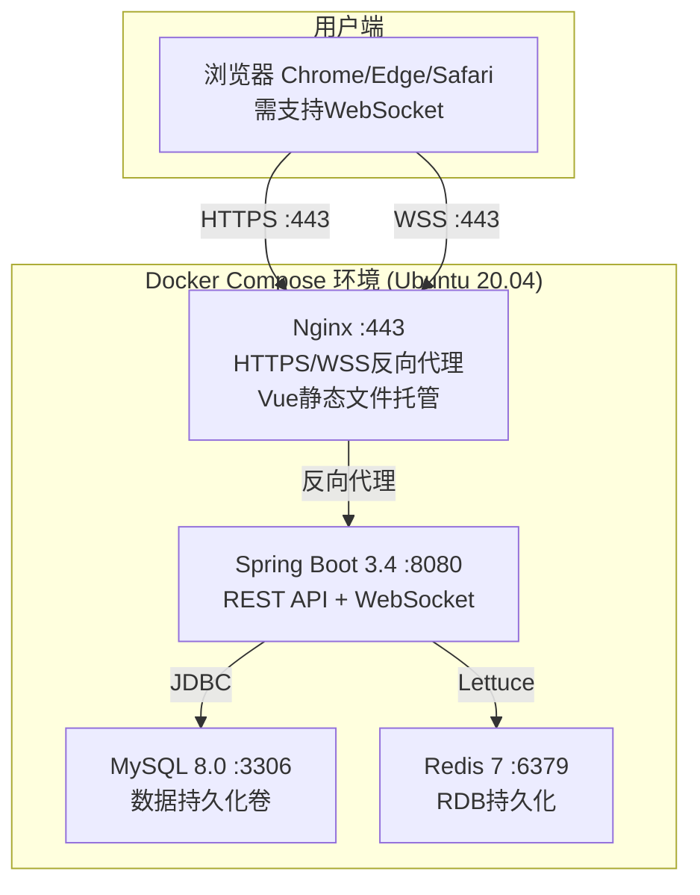

### 2.3 系统构成

本系统采用前后端分离 + 三层架构的体系结构。前端Vue 3单页应用由Nginx托管静态文件。后端Spring Boot应用按6个功能模块垂直拆分，公共横切关注点（Security/JWT/Exception/Logging）抽取为common模块。数据访问层使用MyBatis-Plus操作MySQL，Spring Data Redis操作Redis缓存。实时通信层使用Spring WebSocket + STOMP协议内嵌于业务模块中。

**【功能模块划分】**

- **M1 — 用户与认证模块**：注册登录、JWT鉴权、RBAC权限、个人信息管理
- **M2 — 商品发布与搜索模块**：发布（一口价/拍卖）、多图上传、全文搜索、分类筛选、收藏
- **M3 — 实时拍卖引擎模块**：英式升价拍卖、Redis Lua原子出价、STOMP实时推送、定时判定成交
- **M4 — 即时通讯模块(IM)**：一对一私聊、文字+图片、WebSocket实时收发、已读标记
- **M5 — 订单与交易模块**：订单状态机、模拟支付、发货确认收货
- **M6 — 管理后台与统计模块**：用户审核、商品管理、数据统计ECharts看板

> **图2-2 系统体系结构图**

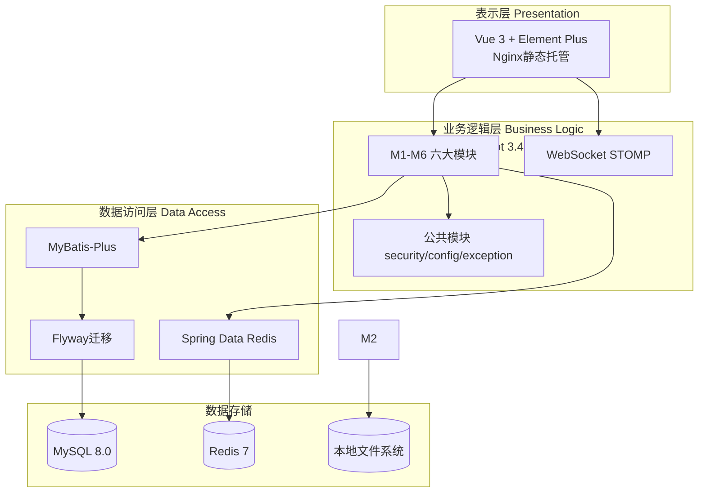

### 2.4 功能整体图

#### 2.4.1 模块层次方框图

> **图2-3 模块层次方框图**

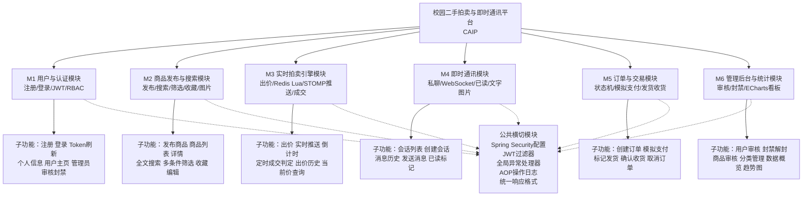

#### 2.4.2 系统用例图

> **图2-4 系统用例图**

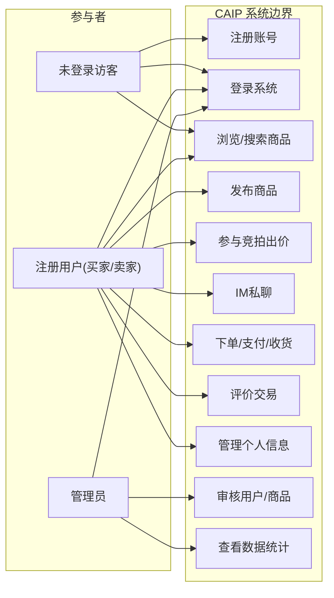

#### 2.4.3 UML图中无法记述的补充事项

模块层次方框图和用例图表达了系统的静态功能分解和参与者-用例关系，但以下动态行为和设计约束无法在图中充分体现，在此补充说明。

**(1) 模块间交互关系（非方框图的层次关系）**

方框图仅表达了模块的层次分解，未表达模块间的动态调用关系。实际上6个模块之间存在紧密的业务协作：

- **M3拍卖引擎 → M5订单交易**：拍卖成交后，M3自动调用M5的 `OrderService.createOrder()` 接口生成订单。这是最关键的跨模块调用链，涉及Redis读取winner → products表更新 → orders表插入的事务一致性
- **M3拍卖引擎 → M4即时通讯**：拍卖成交或流拍后，M3通过M4的WebSocket通道向买卖双方推送系统通知消息
- **M2商品发布 → M3拍卖引擎**：type='AUCTION'的商品发布后，M3读取auction_start/auction_end字段接管拍卖生命周期
- **M2商品发布 → M6管理后台**：新用户首次发布商品（status=PENDING）须经M6管理员审核通过后才公开（status=ACTIVE）
- **M1用户认证 → 全部模块**：所有模块的接口调用均须经过M1的JwtAuthenticationFilter进行Token校验，Controller层通过@PreAuthorize进行角色校验
- **M4即时通讯 → M2商品浏览**：IM会话可通过product_id关联到具体商品，从商品详情页"联系卖家"按钮发起

**(2) 功能优先级（MVP增量交付策略）**

采用增量开发模型，功能按优先级分批交付：

- **第2周 Sprint1（核心功能，必须交付）**：M1用户注册登录(JWT) + M2商品发布浏览 + M3拍卖出价核心逻辑（出价→Redis→STOMP推送→成交判定）
- **第3周 Sprint2（完整功能，必须交付）**：M4即时通讯 + M5订单状态机 + M6管理后台基本功能
- **扩展功能（选做，视进度）**：代理出价（自动竞价上限）、校内摊位LBS地图、热门商品推荐

**(3) 功能间的数据依赖关系**

- 拍卖出价(M3)依赖M2提供的商品起拍价(start_price)和拍卖结束时间(auction_end)
- 订单生成(M5)依赖M2提供的商品卖家信息(seller_id)和M3提供的成交价(current_price)与得主(winner_id)
- IM会话(M4)可选关联M2的product_id，形成"针对某商品的对话"的业务上下文
- 信誉评价(M6)依赖M5的订单完成状态(COMPLETED)作为评价资格的判断条件

**(4) 非功能约束在各模块中的体现**

以下非功能需求虽未在功能图中表达，但贯穿于各模块的设计实现：

- **安全性**：所有模块接口（除登录注册外）均须JWT认证。拍卖出价(M3)须校验出价者≠卖家本人。订单操作(M5)须校验操作者为买家或卖家本人。管理后台(M6)须校验ADMIN角色
- **性能**：M3拍卖出价使用Redis Lua脚本保证原子性（<1ms延迟）。M2商品搜索使用MySQL ngram全文索引。M4 IM消息使用WebSocket直推（无中间MQ积压）
- **并发控制**：M3出价使用Redis Lua脚本原子操作，防超卖和价格不一致。M2库存（如扩展到限量一口价）使用乐观锁。M5订单状态变更使用版本号乐观锁
- **数据一致性**：M3拍卖成交后更新product表+创建order表在同一数据库事务中完成。Redis出价缓存在成交后同步清除，下次读取从MySQL加载

**(5) 用户旅程与模块切换路径**

典型的用户完整操作路径涉及多个模块的串联（用例图仅表达单个用例的参与关系）：

- **买家拍卖旅程**：浏览商品(M2)→查看详情(M2)→出价(M3)→实时收到推送(M3)→拍卖成交→查看订单(M5)→IM沟通细节(M4)→模拟支付(M5)→确认收货(M5)→评价(M6)
- **卖家发布旅程**：发布拍卖商品(M2)→等待审核(M6)→拍卖开始→收到出价推送(M3)→拍卖成交→查看订单(M5)→IM沟通(M4)→发货(M5)→确认买家收货→收到评价(M6)
- **管理员工作流**：登录→仪表盘概览(M6)→待审核用户列表(M6)→审核通过/驳回(M6)→待审核商品列表(M6)→通过/下架(M6)→查看交易趋势统计(M6)

### 2.5 用户分类和特征

#### 2.5.1 用户一览表

| NO | 用户 | 别名/角色标识 | 简要说明 |
|:--:|------|:--:|------|
| 1 | 未登录访客 | ANONYMOUS | 未登录的浏览者，可查看公开商品信息和用户主页，但不能交易 |
| 2 | 普通用户（买家/卖家） | USER | 在校学生或教职工，经学号/工号认证注册。同一账号可兼具买家和卖家两种身份 |
| 3 | 管理员 | ADMIN | 平台运营维护者，由系统在数据库中直接指定（不开放注册），负责审核和监管 |

#### 2.5.2 各用户角色的职责

**1. 未登录访客（ANONYMOUS）**

通过浏览器访问平台首页，可以浏览热门商品和推荐内容、搜索商品、查看商品详情（图片、描述、当前出价）。可以查看任意用户的公开主页（信誉分、历史评价）。但无法发布商品、出价、私聊或下单——这些操作需要先注册登录。

- 浏览商品Feed流（首页推荐 + 分类浏览）
- 搜索商品（关键词 + 分类 + 价格区间筛选）
- 查看商品详情（图片轮播、商品信息、出价记录）
- 查看用户公开主页（信誉分、评价列表）

**2. 普通用户 — 买家/卖家（USER）**

平台的主要使用者群体。同一用户可作为买家参与竞拍和购买，也可作为卖家发布商品。用户通过学号/工号注册后须经管理员审核身份（审核通过后status=ACTIVE）。信誉分≥80的老用户发布商品免审核。

- **作为买家**：浏览商品、搜索筛选、收藏商品、参与拍卖出价（实时竞价）、与卖家IM私聊、下单购买、模拟支付、确认收货、评价交易
- **作为卖家**：发布商品（一口价或拍卖，多图上传+分类标签）、编辑商品信息、查看出价记录、与买家IM私聊、标记发货、查看订单、收到评价
- **管理个人信息**：编辑头像/昵称/手机号/简介、查看我的发布/我的竞拍/我的收藏/我的订单

**3. 管理员（ADMIN）**

平台运营维护者，负责审核用户身份、管理商品内容、监管拍卖行为、查看运营数据。由系统通过数据库直接指定（不开放注册通道）。拥有全部功能权限。

- 用户管理：查看用户列表（搜索+分页+状态筛选）、审核新注册用户身份（通过/驳回）、封禁违规用户/解除封禁
- 商品管理：查看商品列表（按审核状态筛选）、审核通过新发布商品、下架违规商品
- 拍卖监管：查看进行中的拍卖列表、监控异常出价行为（同一用户短时间内频繁出价）
- 分类管理：增删改查商品分类标签（树形结构，支持无限层级）
- 数据统计：仪表盘概览（用户数/商品数/今日订单/今日成交额）、交易趋势图（ECharts折线图）、分类占比（饼图）、用户活跃度（柱状图）、拍卖成交率（仪表盘）

#### 2.5.3 用户对象关系图

> **图2-5 用户对象关系图**

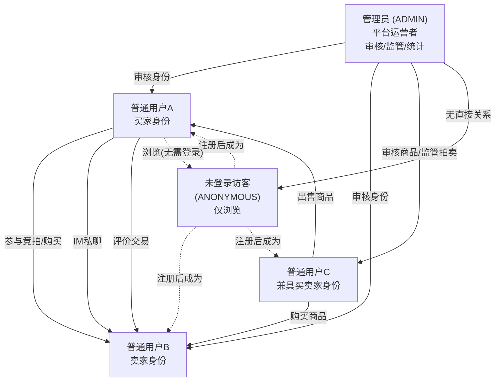

补充说明：

- **注册升级**：未登录访客通过注册（学号+邮箱）并经过管理员审核后，升级为USER角色
- **一人双身份**：同一个USER账号可以在不同场景下作为买家（浏览/出价/购买）或卖家（发布/发货/收款），无需切换账号
- **管理员封闭**：ADMIN不开放注册，由系统在数据库中直接指定。管理员不具备买卖家交易功能（管理后台独立于用户端交易功能）
- **买卖家对称**：所有USER之间可以自由进行买卖。买家和卖家之间存在出价→成交→订单→IM→评价的交互链
- **访客降级**：未登录访客只能单向浏览，无法与任何用户产生交易或消息交互

#### 2.5.4 功能模块与用户的对应一览表

| 功能模块 | 未登录访客 | 普通用户(买家) | 普通用户(卖家) | 管理员 |
|---------|:--:|:--:|:--:|:--:|
| M1 用户注册与登录 | ●（注册/登录） | ●（登录/个人信息） | ●（登录/个人信息） | ●（登录） |
| M1 用户资料管理 | — | ●（编辑自己的资料） | ●（编辑自己的资料） | — |
| M1 用户审核与封禁 | — | — | — | ● |
| M2 商品浏览与搜索 | ● | ● | ● | ● |
| M2 商品发布 | — | — | ● | — |
| M2 商品收藏 | — | ● | ● | — |
| M3 拍卖出价 | — | ● | — | — |
| M3 拍卖成交判定 | — | — | — | —（系统自动） |
| M3 拍卖监管 | — | — | — | ● |
| M4 IM即时通讯 | — | ● | ● | — |
| M5 订单创建 | — | ●（一口价购买） | —（拍卖成交系统自动） | — |
| M5 订单支付/收货 | — | ● | — | — |
| M5 订单发货 | — | — | ● | — |
| M6 商品审核与下架 | — | — | — | ● |
| M6 分类标签管理 | — | — | — | ● |
| M6 数据统计看板 | — | — | — | ● |
| M6 交易评价 | — | ● | ● | — |

**图例**：● 有权限　— 无权限

**补充说明：**

- 拍卖成交判定（M3）为系统定时任务自动执行，无需任何用户角色触发
- 普通用户的"买家"和"卖家"身份是同一账号在不同操作中的角色切换，不是两个独立的用户类型
- 管理员拥有查看所有功能模块的权限，但不参与具体交易（不买卖、不出价、不私聊）

---

## 3. 外部接口需求

### 3.1 用户接口

#### 3.1.1 前端页面清单

| 页面路由 | 页面名称 | 说明 |
|---------|---------|------|
| `/` | 首页 | 商品Feed流 + 热门拍卖推荐 + 分类入口 |
| `/login` | 登录页 | 学号 + 密码登录 |
| `/register` | 注册页 | 学号 + 邮箱 + 密码 + 手机号 |
| `/product/:id` | 商品详情页 | 图片轮播 + 一口价购买/拍卖竞价 + 卖家信息 |
| `/product/create` | 发布商品页 | 表单：标题/描述/图片/分类/类型/价格/时长 |
| `/search` | 搜索结果页 | 筛选栏 + 商品卡片列表 |
| `/chat` | 消息列表页 | 会话列表 |
| `/chat/:userId` | 聊天窗口 | 消息气泡 + 输入框 + 图片发送 |
| `/user/:id` | 用户主页 | 信誉评分 + 交易记录 + 评价列表 |
| `/user/profile` | 个人资料 | 编辑头像/昵称/手机号/简介 |
| `/orders` | 我的订单 | 订单列表 + 状态筛选（待付款/已发货/已完成） |
| `/admin` | 管理后台首页 | 仪表盘概览 |
| `/admin/users` | 用户管理 | 审核列表 + 封禁操作 |
| `/admin/products` | 商品管理 | 审核列表 + 下架操作 |
| `/admin/stats` | 数据统计 | 图表看板 |

#### 3.1.2 画面与功能对应详细说明

**首页（P01）— `/`**

显示商品Feed流（按发布时间倒序）、热门拍卖推荐（按浏览量排序）、分类快捷入口、顶部搜索栏。面向所有用户（含未登录）。特别要求：首次加载显示骨架屏，图片懒加载。

**登录页（P02）— `/login`**

学号+密码登录表单。登录成功后跳转至首页。登录失败显示具体错误提示（"用户名或密码错误"/"账号已被封禁"）。特别要求：连续5次登录失败锁定账号15分钟。

**注册页（P03）— `/register`**

学号、邮箱、密码（确认密码）、手机号注册表单。前端实时校验：学号为数字格式、邮箱格式、两次密码一致、密码长度≥8位含字母数字。提交后提示"注册成功，请等待管理员审核"。

**商品详情页（P04）— `/product/:id`**

商品信息区域：图片轮播（点击放大）、标题、描述、分类标签、发布时间、浏览量、卖家信息卡片。交易区域分两种模式：一口价模式显示"立即购买"按钮和固定价格；拍卖模式显示当前最高价（实时WebSocket更新）、出价输入框（须>当前价）、拍卖倒计时、最新出价记录列表、"联系卖家"按钮。特别要求：拍卖模式下倒计时归零后，出价输入框自动隐藏，显示成交结果（得主信息）或流拍提示。

**发布商品页（P05）— `/product/create`**

表单：标题（必填，≤200字）、描述（选填，富文本）、图片上传（多图拖拽或点击上传，每张≤5MB，支持jpg/png/gif/webp）、分类选择（下拉树形）、交易模式切换（一口价/拍卖）、价格设置（一口价模式显示"价格"，拍卖模式显示"起拍价+拍卖时长"）。特别要求：表单内容在localStorage自动暂存草稿，防止误关页面丢失。

**搜索结果页（P06）— `/search`**

筛选面板（左侧）：分类树形筛选、价格区间（最低-最高）、交易类型（一口价/拍卖）。排序栏（顶部）：最新发布/价格升序/价格降序/最多浏览。结果列表（右侧）：商品卡片分页展示。特别要求：搜索结果页URL可分享（查询参数保留在URL中）。

**IM消息列表页（P07）— `/chat`**

会话列表（按最后消息时间倒序），每项显示对方头像+昵称+最后消息摘要+未读消息红点数字。空状态显示"暂无消息"插画。

**IM聊天窗口（P08）— `/chat/:userId`**

消息气泡列表（己方靠右绿底，对方靠左白底）、文字输入框（Enter发送，Shift+Enter换行）、图片发送按钮、顶部显示对方信息+关联商品卡片。进入窗口时自动标记对方消息为已读。特别要求：WebSocket断开时消息通过HTTP降级发送，前端显示重连提示。

**用户主页（P09）— `/user/:id`**

用户信息区域：头像、昵称、信誉分数值。交易统计：成交数量、好评率百分比。历史评价列表：评价者头像+昵称+评分星星+评价内容+时间。

**个人资料页（P10）— `/user/profile`**

头像上传（点击更换）、昵称（输入框）、手机号（输入框+格式校验）、个人简介（多行文本）。保存按钮提交后更新。

**我的订单页（P11）— `/orders`**

状态筛选Tab：全部 / 待付款 / 已发货 / 已完成。订单列表每项显示商品缩略图+标题+成交金额+状态标签+操作按钮。操作按钮按状态变化：待付款→"立即支付"+"取消订单"；已付款→（卖家看到"标记发货"）；已发货→"确认收货"；已完成→"去评价"。

**管理后台 — `/admin/*`**（共3个管理页面，仅ADMIN角色可访问）

- `/admin/users` 用户管理：用户列表（搜索+分页+状态筛选）、待审核用户高亮、"通过"/"驳回"按钮、封禁/解封操作
- `/admin/products` 商品管理：商品列表（搜索+分页+状态筛选）、"通过"/"下架"按钮
- `/admin/stats` 数据统计：ECharts图表—交易额趋势折线图、分类占比饼图、用户活跃度柱状图、拍卖成交率仪表盘

#### 3.1.3 交互设计原则与安全要求

**交互设计原则：**
- 响应式设计，适配桌面和移动端浏览器
- 拍卖页面关键操作（出价）按钮防重复点击
- 表单提交实时校验（前端 + 后端双重验证）
- 关键操作（发布商品/出价/下单）有确认提示
- WebSocket断线自动重连（指数退避）

**用户接口安全设计要求：**
- 登录状态保持：JWT AccessToken（30分钟）存储于localStorage；RefreshToken（7天）存储于httpOnly Cookie
- 敏感操作确认：出价、下单支付、确认收货须弹出二次确认对话框
- 防越权：前端路由守卫 + 后端`@PreAuthorize`双重校验；用户只能操作自己的资源
- 表单输入校验：前端Element Plus表单验证（失焦+提交触发）+ 后端Spring Validation（`@Valid`）双重校验

### 3.2 硬件接口

本系统为纯Web应用，无特殊硬件接口需求。系统通过标准TCP/IP网络协议与客户端通信，运行于通用x86_64架构服务器。以下硬件接口均不涉及：

- 无串口（RS-232/RS-485）设备通信
- 无USB外设直接通信
- 无蓝牙/NFC外设通信
- 无PCI/PCIe设备驱动调用
- 无打印机、扫描仪等外接设备

输入设备为标准键盘和鼠标（桌面端）或触摸屏（移动端），输出设备为标准显示器或手机屏幕。

### 3.3 软件接口

#### 3.3.1 数据库接口 — MySQL 8.0

- **接口功能**：提供全部业务数据的持久化存储与查询。系统所有模块（M1-M6）的增删改查操作均通过此接口完成
- **DBMS**：MySQL 8.0.36
- **连接方式**：JDBC，驱动程序 `mysql-connector-j` 8.3.0
- **连接池**：HikariCP 5.1.0（Spring Boot 3.4默认），最大连接数20，最小空闲5
- **连接参数**：`jdbc:mysql://localhost:3306/campus_auction?useUnicode=true&characterEncoding=utf8mb4&serverTimezone=Asia/Shanghai`
- **ORM框架**：MyBatis-Plus 3.5.7（Lambda查询 + 分页插件）
- **迁移工具**：Flyway 10.x，迁移脚本位于 `src/main/resources/db/migration/`

#### 3.3.2 缓存接口 — Redis 7

- **接口功能**：提供高性能缓存服务。具体场景：拍卖当前最高出价缓存（实时读写）、用户Session共享、在线用户状态维护、热门商品排行榜（Sorted Set）
- **Redis版本**：Redis 7.2
- **连接方式**：Redis Serialization Protocol (RESP)，客户端Lettuce 6.3（Spring Data Redis 3.2内置）
- **连接参数**：`redis://localhost:6379`，连接池最大活跃20、最大空闲10
- **数据结构使用**：String — 拍卖当前价(`auction:{id}:price`)、拍卖得主(`auction:{id}:winner`)；Set — 在线用户集合；Sorted Set — 热门商品排行

#### 3.3.3 文件存储接口

- **接口功能**：存储用户上传的商品图片
- **存储路径**：开发环境 `./uploads/images/`，生产环境 `/data/caip/uploads/images/`
- **文件命名规则**：`{UUID}.{原始扩展名}`（如 `a1b2c3d4-e5f6.jpg`），防遍历
- **访问方式**：Spring Boot静态资源配置 `/uploads/**` 映射到文件系统路径
- **预留接口**：`FileStorageService` 接口可切换实现为阿里云OSS或MinIO对象存储

生产环境使用MinIO自建对象存储，或接入阿里云OSS。

#### 3.3.4 外部系统依赖

本系统为完全独立部署，无外部系统依赖。

- 支付功能：使用模拟支付（点击按钮即变更为"已支付"状态），不接入微信支付/支付宝等第三方支付网关
- 短信/邮件：使用站内通知（notifications表 + WebSocket推送）代替
- 校园认证：学号+管理员人工审核方案，不接入学校统一身份认证系统（SSO/CAS/OAuth）
- 推荐算法：使用简单"热门排行"（浏览量+收藏数+成交数加权排序），不接入推荐引擎

### 3.4 通讯接口

#### 3.4.1 通讯接口总览

| 接口类型 | 协议 | 端点格式 | 说明 |
|---------|------|---------|------|
| REST API | HTTPS | `/api/v1/**` | JSON请求/响应，SpringDoc自动生成Swagger文档 |
| WebSocket（拍卖） | WSS | `/ws/auction/{productId}` | 拍卖出价实时推送，STOMP Topic订阅模式 |
| WebSocket（IM） | WSS | `/ws/chat` | IM实时通信，STOMP点对点模式 |

#### 3.4.2 REST API 通讯接口

- **接口名称**：RESTful HTTP API
- **接口功能**：提供前端所有业务操作的HTTP接口
- **通信协议**：HTTPS (TLS 1.3)
- **数据格式**：请求 `Content-Type: application/json`，响应 `Content-Type: application/json`
- **认证方式**：JWT Bearer Token，请求头 `Authorization: Bearer eyJhbG...`
- **API文档**：SpringDoc OpenAPI 2.6自动生成，访问 `/swagger-ui.html`

**统一响应格式：**

```json
{
  "code": 200,
  "message": "操作成功",
  "data": {},
  "timestamp": 1717507200000
}
```

**统一分页格式：**

```json
{
  "total": 150,
  "page": 1,
  "size": 20,
  "items": []
}
```

**请求示例（登录）：**

```
POST /api/v1/auth/login HTTP/1.1
Host: campus-auction.example.com
Content-Type: application/json

{
  "studentId": "2021300001",
  "password": "abc123"
}
```

**响应示例（登录成功）：**

```json
{
  "code": 200,
  "message": "登录成功",
  "data": {
    "accessToken": "eyJhbGciOiJIUzI1NiJ9...",
    "refreshToken": "eyJhbGciOiJIUzI1NiJ9...",
    "userInfo": {
      "id": 1,
      "studentId": "2021300001",
      "username": "张三",
      "avatar": "/uploads/images/abc.jpg",
      "reputationScore": 100
    }
  },
  "timestamp": 1717507200000
}
```

#### 3.4.3 拍卖出价 WebSocket 接口

- **接口名称**：拍卖出价实时推送接口
- **接口功能**：实时推送某商品的出价更新给所有正在围观该商品的用户
- **通信协议**：WSS (WebSocket Secure) + STOMP子协议
- **通信方式**：发布-订阅（Publish-Subscribe），服务端发布到 `/topic/auction/{productId}`，订阅该Topic的客户端实时收到推送
- **连接认证**：STOMP CONNECT帧携带 `Authorization: Bearer <token>` 头

**新出价推送消息格式：**

```json
{
  "type": "NEW_BID",
  "payload": {
    "productId": 123,
    "bidId": 456,
    "bidAmount": 85.00,
    "currentPrice": 85.00,
    "bidderId": 10,
    "bidderName": "张三",
    "bidTime": "2026-06-09T14:30:00"
  },
  "timestamp": 1717933800000
}
```

**拍卖结束推送消息格式：**

```json
{
  "type": "AUCTION_END",
  "payload": {
    "productId": 123,
    "winnerId": 10,
    "winnerName": "张三",
    "finalPrice": 85.00,
    "totalBids": 12
  },
  "timestamp": 1717935000000
}
```

#### 3.4.4 IM即时通讯 WebSocket 接口

- **接口名称**：IM即时通讯接口
- **接口功能**：实现买卖双方一对一实时私聊
- **通信协议**：WSS + STOMP
- **通信方式**：点对点（Point-to-Point），发送方发送到 `/app/chat.send`，服务端转发到 `/user/{userId}/queue/chat`
- **连接认证**：STOMP CONNECT帧携带Token

**IM消息格式：**

```json
{
  "type": "NEW_MESSAGE",
  "payload": {
    "messageId": 789,
    "conversationId": 50,
    "senderId": 10,
    "senderName": "张三",
    "senderAvatar": "/uploads/images/abc.jpg",
    "content": "这个还在吗？",
    "contentType": "TEXT",
    "createdAt": "2026-06-09T14:35:00"
  },
  "timestamp": 1717934100000
}
```

**WebSocket统一消息信封：**

```json
{
  "type": "NEW_BID | AUCTION_END | NEW_MESSAGE | NOTIFICATION",
  "payload": { },
  "timestamp": 1717507200000,
  "sender": "userId"
}
```

#### 3.4.5 CORS安全配置

- 允许来源：`https://campus-auction.example.com`, `http://localhost:5173`（开发环境）
- 允许方法：GET, POST, PUT, DELETE, OPTIONS
- 允许头部：Authorization, Content-Type
- 允许凭证：true（支持携带Cookie的RefreshToken）
- 预检缓存：3600秒

---

## 4. 实现方式

---

### 4.1 用户与认证功能 (M1)

#### 4.1.1 功能概要

提供用户注册、登录、JWT无状态认证、个人信息管理功能。支持学号+邮箱注册，密码使用BCrypt加密存储（强度10）。通过Spring Security框架 + JWT实现基于角色的访问控制（RBAC）。

**认证流程：**

- 注册流程：用户提交注册信息 → 校验学号+邮箱唯一性 → BCryptPasswordEncoder加密密码 → 写入users表（role='USER', status='PENDING'等待管理员审核）→ 返回注册成功
- 登录流程：用户提交学号+密码 → UserService通过userMapper查询用户 → BCrypt.matches()校验密码 → JwtTokenProvider.generateToken()生成AccessToken(30分钟)和RefreshToken(7天) → 返回Token对
- 鉴权流程：每个请求Authorization头携带Bearer Token → JwtAuthenticationFilter拦截 → 解析验证Token → 将用户信息写入SecurityContext → @PreAuthorize注解校验角色权限

#### 4.1.2 功能详细

**① 用户注册（M1-F01）**

- 输入：RegisterDTO { studentId, email, password, phone }
- 处理：校验学号和邮箱唯一性 → BCrypt加密密码 → 插入users表（role='USER', reputation_score=100, status='PENDING'）
- 输出：成功消息 + 提示"请等待管理员审核"
- 权限：无需登录

**② 用户登录（M1-F02）**

- 输入：LoginDTO { studentId, password }
- 处理：查询用户 → BCrypt校验密码 → 校验账号状态（BANNED则拒绝） → 生成JWT Token对 → 记录登录时间
- 输出：LoginVO { accessToken, refreshToken, userInfo(id, studentId, username, avatar, reputation_score, role) }
- 权限：无需登录

**③ Token刷新（M1-F03）**

- 输入：RefreshToken字符串
- 处理：验证RefreshToken签名和有效期 → 提取userId → 生成新的AccessToken(30分钟)
- 输出：新AccessToken
- 权限：无需登录（但RefreshToken须有效）

**④ 获取个人信息（M1-F04）**

- 输入：无（从JWT中提取userId）
- 处理：查询users表 → 组装UserVO
- 输出：UserVO { id, studentId, username, email, phone, avatar, reputation_score, role, status }
- 权限：须登录（USER或ADMIN）

**⑤ 编辑个人信息（M1-F05）**

- 输入：UpdateUserDTO { nickname, phone, avatar? }
- 处理：校验手机号格式 → 如有新头像则上传文件返回URL → 更新users表对应字段
- 输出：更新后的UserVO
- 权限：须登录，只能编辑自己的信息

**⑥ 查看用户主页（M1-F06）**

- 输入：userId（URL路径参数）
- 处理：查询用户公开信息 → 统计交易数量（COUNT orders WHERE buyer_id=? OR seller_id=? AND status='COMPLETED'） → 统计好评率（AVG reviews.rating WHERE target_user_id=?） → 查询最近10条评价
- 输出：UserProfileVO { userInfo, tradeCount, goodRate, recentReviews[] }
- 权限：所有用户（含未登录）

**⑦ 管理员-身份审核（M1-F07）**

- 输入：userId, 审核结果（APPROVED/REJECTED）
- 处理：@PreAuthorize("hasRole('ADMIN')")校验 → UPDATE users SET status='ACTIVE' 或保持'PENDING'+发送驳回通知
- 输出：成功消息 + WebSocket推送通知给被审核用户
- 权限：仅ADMIN

**⑧ 管理员-封禁/解封（M1-F08）**

- 输入：userId, 操作类型（BAN/UNBAN）
- 处理：ADMIN权限校验 → UPDATE users SET status='BANNED'/'ACTIVE'
- 输出：成功消息
- 权限：仅ADMIN

#### 4.1.3 相关功能

| 组件名 | 说明 | 关系 |
|--------|------|------|
| M3 拍卖引擎 | 拍卖出价操作 | 所有出价操作须通过JwtAuthenticationFilter验证，@PreAuthorize("isAuthenticated()") |
| M4 IM通讯 | 即时通讯 | 发送消息时从SecurityContext获取当前用户ID作为sender_id；STOMP CONNECT帧中提取JWT验证 |
| M5 订单交易 | 订单操作 | 支付/发货/收货操作须验证操作者为买家或卖家本人，通过@PreAuthorize + SpEL表达式校验 |
| M6 管理后台 | 管理功能 | 所有/admin/**接口标注@PreAuthorize("hasRole('ADMIN')") |

#### 4.1.4 用户接口

| 接口 | 方法 | 认证 | 说明 |
|------|:--:|:--:|------|
| `/api/v1/auth/register` | POST | 无 | 注册新用户 |
| `/api/v1/auth/login` | POST | 无 | 登录，返回JWT Token对 |
| `/api/v1/auth/refresh` | POST | 无 | 刷新AccessToken |
| `/api/v1/users/me` | GET | 需 | 获取当前登录用户信息 |
| `/api/v1/users/me` | PUT | 需 | 编辑个人信息 |
| `/api/v1/users/{id}` | GET | 需 | 查看任意用户公开主页 |

> **图4-1 用户模块类图**

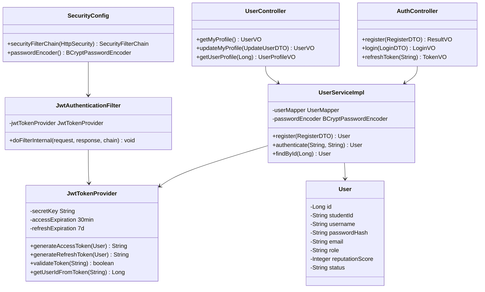

> **图4-2 登录认证时序图**

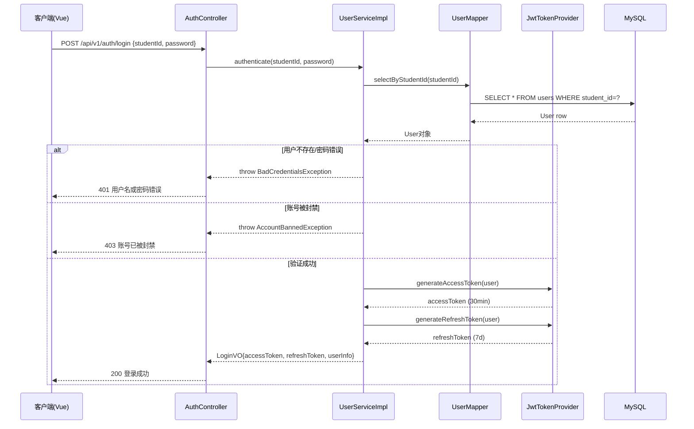

---

### 4.2 商品发布与搜索功能 (M2)

#### 4.2.1 功能概要

提供商品发布（一口价和拍卖两种模式）、商品列表浏览、全文搜索、多条件筛选、商品收藏功能。支持多图上传和分类标签管理。新用户发布商品需管理员审核，信誉分≥80的老用户自动审核通过。

#### 4.2.2 功能详细

**① 发布商品（M2-F01）**

- 输入：ProductCreateDTO { title, description, images[], categoryId, type(SALE/AUCTION), price, auctionDuration? }
- 处理：校验图片类型(jpg/png/gif/webp)和大小(≤5MB) → 逐个上传图片返回URL数组 → 创建Product记录（status=PENDING）→ 关联product_images记录 → 信誉分≥80自动审核通过(status=ACTIVE)，否则等待管理员审核
- 输出：ProductVO
- 权限：USER

**② 商品列表（M2-F02）**

- 输入：page, size, sort(created_at/price/view_count)
- 处理：分页查询status='ACTIVE'的商品 → 关联卖家信息(username, avatar)和首张图片(sort_order=0)
- 输出：Page<ProductCardVO>
- 权限：无需认证

**③ 商品详情（M2-F03）**

- 输入：productId（URL路径参数）
- 处理：查询product + product_images + seller信息 → 若type=AUCTION则关联最新出价记录 → view_count+1
- 输出：ProductDetailVO { productInfo, images[], sellerInfo{}, latestBid?{} }
- 权限：无需认证

**④ 全文搜索（M2-F04）**

- 输入：q(关键词), categoryId, minPrice, maxPrice, type, sort, page, size
- 处理：MySQL ngram全文索引搜索title+description → 多条件动态SQL筛选 → 分页排序。若全文索引无结果，降级为LIKE '%关键词%'模糊搜索
- 输出：Page<ProductCardVO>
- 权限：无需认证

**搜索SQL（核心查询逻辑）：**

```sql
SELECT p.*, pi.image_url AS cover_image
FROM products p
LEFT JOIN product_images pi ON p.id = pi.product_id AND pi.sort_order = 0
WHERE p.status = 'ACTIVE'
  AND MATCH(p.title, p.description) AGAINST(? IN BOOLEAN MODE)
  AND (? IS NULL OR p.category_id = ?)
  AND (? IS NULL OR p.current_price BETWEEN ? AND ?)
  AND (? IS NULL OR p.type = ?)
ORDER BY CASE ?
  WHEN 'price_asc' THEN p.current_price END ASC,
  CASE ? WHEN 'created_at' THEN p.created_at END DESC
LIMIT ?, ?
```

MySQL全文索引配置：

```sql
ALTER TABLE products ADD FULLTEXT INDEX ft_products_search (title, description) WITH PARSER ngram;
SET GLOBAL ngram_token_size = 2;
```

**⑤ 收藏/取消收藏（M2-F05）**

- 输入：productId
- 处理：查询product_favorites表是否已有记录 → 有则DELETE（取消），无则INSERT（收藏）
- 输出：当前收藏状态（true/false）
- 权限：USER

**⑥ 我的收藏（M2-F06）**

- 输入：page, size
- 处理：分页查询当前用户收藏的商品
- 输出：Page<ProductCardVO>
- 权限：USER

#### 4.2.3 相关功能

| 组件名 | 说明 | 关系 |
|--------|------|------|
| M3 拍卖引擎 | 拍卖商品 | type='AUCTION'的商品发布后，M3模块读取auction_start/auction_end启动拍卖 |
| M5 订单交易 | 一口价购买 | type='SALE'商品被购买后调用OrderService.createOrder() |
| M6 管理后台 | 商品审核 | 管理员审核商品（status: PENDING→ACTIVE/BANNED） |

#### 4.2.4 用户接口

| 接口 | 方法 | 说明 |
|------|:--:|------|
| `/api/v1/products` | GET | 商品列表（分页+排序） |
| `/api/v1/products` | POST | 发布商品 |
| `/api/v1/products/{id}` | GET | 商品详情 |
| `/api/v1/products/{id}` | PUT | 编辑商品（仅卖家本人） |
| `/api/v1/products/search` | GET | 搜索筛选（q, cat, min, max, type, sort参数） |
| `/api/v1/products/{id}/favorite` | POST | 收藏/取消 |
| `/api/v1/favorites` | GET | 我的收藏 |

> **图4-3 商品模块类图**

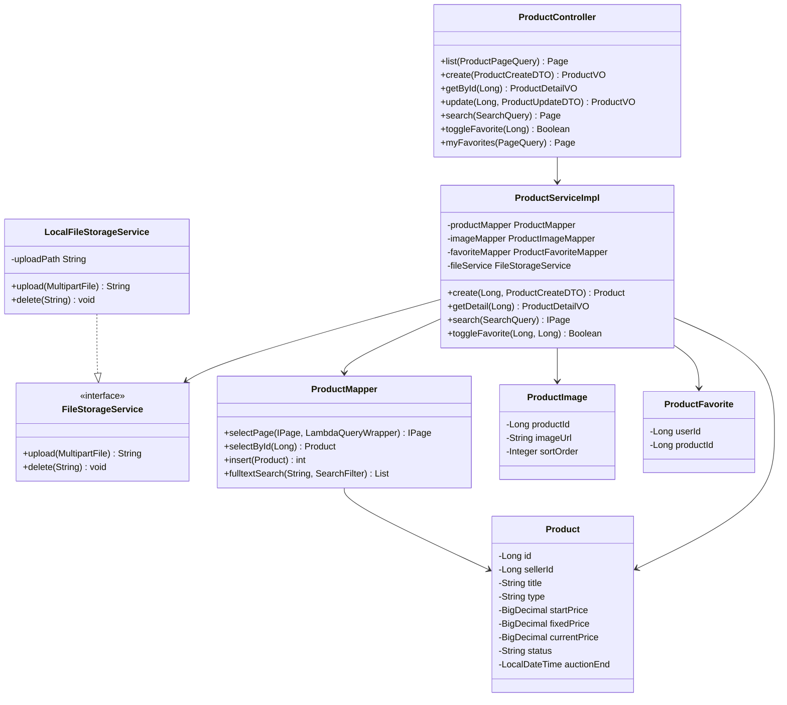

---

### 4.3 实时拍卖引擎功能 (M3)

#### 4.3.1 功能概要

实现英式升价拍卖。买家对进行中的拍卖商品出价，系统通过Redis Lua脚本保证出价操作的原子性（校验 + 更新在一个原子操作中完成），再通过WebSocket (STOMP Topic)将出价实时推送给所有正在围观该商品的用户。拍卖截止后由@Scheduled定时任务自动判定得主（若无出价则流拍），并通知买卖双方。

**拍卖生命周期：**

卖家发布拍卖商品（type=AUCTION, auction_start=NOW, auction_end=NOW+时长）
→ 拍卖进行中（接受用户出价）
→ auction_end到达
→ 有人出价：winner=最高出价者, status=SOLD → 生成订单
→ 无人出价：status=EXPIRED → 流拍

#### 4.3.2 Redis Lua出价脚本

出价操作使用Redis Lua脚本保证原子性，一个Lua调用中完成：读取当前价 → 校验出价>当前价 → 更新当前价和最高出价者。避免高并发下超卖和价格不一致。

```lua
-- auction_place_bid.lua
-- KEYS[1] = auction:{productId}:price
-- KEYS[2] = auction:{productId}:winner
-- ARGV[1] = bidAmount      ARGV[2] = userId
-- ARGV[3] = startPrice     ARGV[4] = sellerId
-- 返回: {0, 错误信息} 或 {1, 新价格}

local currentPrice = redis.call('GET', KEYS[1])
if currentPrice == false then
    currentPrice = ARGV[3]  -- 首次出价，使用起拍价
end

local bidAmount = tonumber(ARGV[1])

-- 卖家不能给自己的商品出价
if ARGV[2] == ARGV[4] then
    return {0, "不能给自己的商品出价"}
end

-- 出价必须高于当前价
if bidAmount <= tonumber(currentPrice) then
    return {0, "出价必须高于当前价" .. currentPrice}
end

redis.call('SET', KEYS[1], ARGV[1])
redis.call('SET', KEYS[2], ARGV[2])
return {1, ARGV[1]}
```

#### 4.3.3 功能详细

**① 出价（M3-F02）—核心功能**

- 输入：productId, bidAmount
- 处理：①校验商品status=ACTIVE且type=AUCTION ②校验拍卖未结束(auction_end > NOW) ③校验出价者不是卖家本人 ④执行Redis Lua脚本原子校验+更新 ⑤成功 → SimpMessagingTemplate.convertAndSend("/topic/auction/{id}", NEW_BID)广播给所有订阅者 ⑥@Async异步持久化bids表
- 输出：BidVO { id, productId, bidAmount, bidTime }
- 权限：USER（须登录）

**② 实时推送（M3-F03）**

- 通信方式：STOMP Topic `/topic/auction/{productId}`
- 消息类型：NEW_BID（新出价）、AUCTION_END（拍卖结束/成交）、AUCTION_EXPIRED（流拍）
- 订阅者：前端页面打开商品详情（拍卖模式）时自动订阅，离开页面时取消订阅

**③ 定时判定成交（M3-F05）**

- 触发：@Scheduled(fixedRate=60000) 每分钟执行一次
- 处理：SELECT到期拍卖 → 从Redis读取最高价和winner → 若有winner→UPDATE products SET status='SOLD', winner_id=? → 调用OrderService.createOrder() → WebSocket广播AUCTION_END；若无winner → UPDATE products SET status='EXPIRED' → 广播流拍
- 防重复执行：Redis SETNX分布式锁 `auction:check:lock`，过期60秒
- 权限：系统定时任务

**④ 查看出价记录（M3-F04）**

- 输入：productId, page, size
- 处理：分页查询bids表（ORDER BY bid_time DESC）
- 输出：Page<BidVO>
- 权限：无需认证

**⑤ 获取当前最高价（M3-F06）**

- 输入：productId
- 处理：redisTemplate.opsForValue().get("auction:{productId}:price")
- 输出：BigDecimal（首次加载时若Redis为空则返回startPrice）
- 权限：无需认证

#### 4.3.4 相关功能

| 组件名 | 说明 | 关系 |
|--------|------|------|
| M2 商品管理 | 拍卖商品基础信息 | 读取商品起拍价和时长；成交/流拍后更新product.status和winner_id |
| M5 订单交易 | 拍卖成交后生成订单 | 拍卖成交后调用orderService.createOrder(productId, winnerId, sellerId, finalPrice) |
| M1 用户认证 | 出价者身份 | 出价须JWT验证，@PreAuthorize("isAuthenticated()") |
| M4 IM通讯 | 通知买卖双方 | 拍卖成交/流拍后通知买卖双方 |

#### 4.3.5 用户接口

| 接口 | 方法 | 说明 |
|------|:--:|------|
| `/api/v1/products/{id}/bids` | GET | 出价记录（分页） |
| `/api/v1/products/{id}/bids` | POST | 提交出价 |
| `/api/v1/products/{id}/current-price` | GET | 当前最高价 |
| `/ws/auction/{productId}` | WS(订阅) | 实时推送（STOMP订阅） |

> **图4-4 拍卖出价时序图**

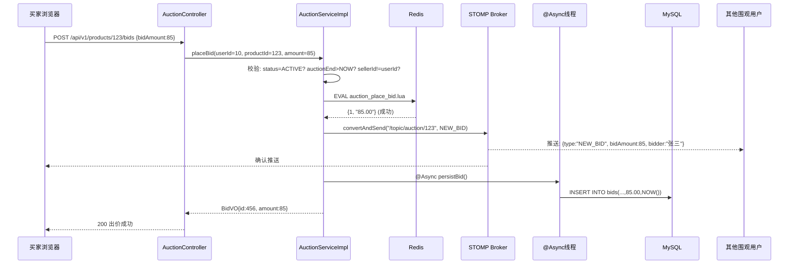

> **图4-5 拍卖成交判定时序图**

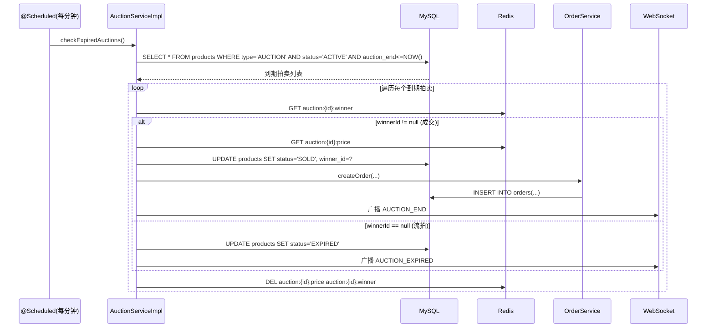

> **图4-6 拍卖模块类图**

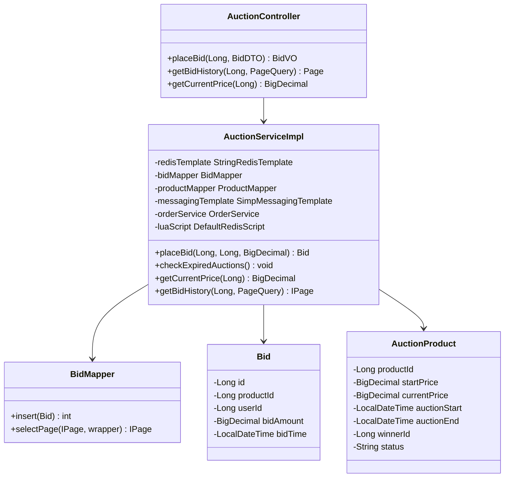

---

### 4.4 即时通讯功能 (M4)

#### 4.4.1 功能概要

实现买卖双方一对一文字+图片私聊功能。使用WebSocket(STOMP)协议进行实时消息收发，同时提供HTTP REST接口作为WebSocket不可用时的降级方案。聊天记录持久化存储在MySQL中。消息已读/未读状态实时更新。

#### 4.4.2 功能详细

**① 获取会话列表（M4-F01）**

- 输入：无（当前用户从SecurityContext获取）
- 处理：查询当前用户参与的所有conversations（user1_id或user2_id等于当前用户）→ 关联对方用户信息 → 计算每个会话的未读消息数（COUNT messages WHERE is_read=0 AND sender_id≠当前用户）→ 按last_message_at倒序
- 输出：List<ConversationVO>（每项含对方头像/昵称、最后消息摘要、未读计数）
- 权限：USER

**② 创建会话（M4-F02）**

- 输入：targetUserId, productId（可选）
- 处理：检查是否已存在相同(user1, user2, product_id)的会话 → 无则创建(user1_id=MIN, user2_id=MAX保证唯一)
- 输出：ConversationVO
- 权限：USER

**③ 获取消息历史（M4-F03）**

- 输入：conversationId, page, size
- 处理：分页查询messages表（ORDER BY created_at ASC正序）→ 同时UPDATE messages SET is_read=1 WHERE conversation_id=? AND sender_id≠当前用户（标记对方消息为已读）
- 输出：Page<MessageVO>
- 权限：USER（须是会话参与方）

**④ 发送消息 — WebSocket（M4-F04，主要方式）**

- 输入：STOMP SEND to `/app/chat.send` { conversationId, content, contentType }
- 处理：从SecurityContext获取senderId → 校验sender属于会话参与方 → messageMapper.insert()持久化MySQL → messagingTemplate.convertAndSendToUser(receiverId, "/queue/chat", messageVO)推送给接收方 → 回执给发送方（含messageId）
- 输出：实时WebSocket推送
- 权限：USER

**⑤ 发送消息 — HTTP降级（M4-F05，备用方式）**

- 输入：POST { conversationId, content, contentType }
- 处理：同上，WebSocket不可用时的HTTP降级方案
- 输出：MessageVO（含messageId）
- 权限：USER

#### 4.4.3 相关功能

| 组件名 | 说明 | 关系 |
|--------|------|------|
| M1 用户认证 | 消息发送者身份 | 发送消息时从SecurityContext获取sender_id；对方在线状态查询 |
| M2 商品浏览 | 从商品发起对话 | 从商品详情页"联系卖家"按钮创建带product_id的会话 |
| M3 拍卖引擎 | 系统通知 | 拍卖成交/流拍后自动发送系统通知消息 |

#### 4.4.4 用户接口

| 接口 | 方法 | 说明 |
|------|:--:|------|
| `/api/v1/conversations` | GET | 会话列表（含未读数） |
| `/api/v1/conversations` | POST | 创建会话 |
| `/api/v1/conversations/{id}/messages` | GET | 消息历史（分页，正序） |
| `/api/v1/conversations/{id}/messages` | POST | 发送消息（HTTP降级） |
| `/api/v1/conversations/{id}/read` | PUT | 标记已读 |
| `/ws/chat` | WS(双向) | IM实时通信（STOMP双向，主要方式） |

> **图4-7 IM消息收发时序图**

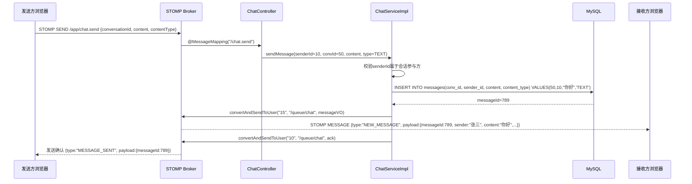

> **图4-8 IM模块类图**

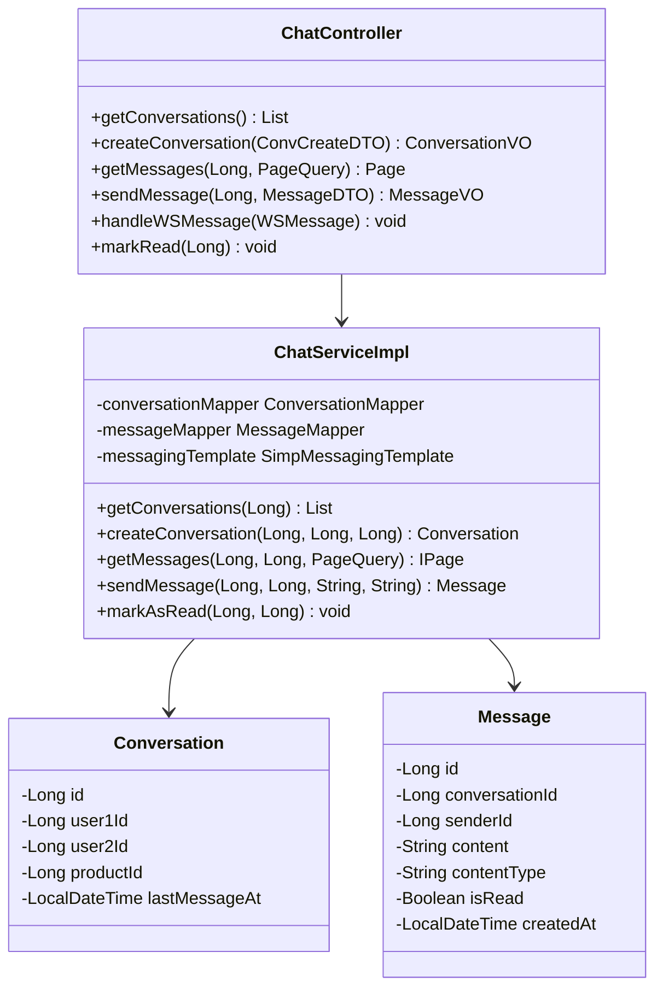

---

### 4.5 订单与交易功能 (M5)

#### 4.5.1 功能概要

管理订单全生命周期。订单来源有两类：(a)拍卖成交后由M3模块自动生成；(b)一口价商品由买家点击"立即购买"后生成。实现订单状态机，严格控制各状态间的合法跳转。提供模拟支付功能。

**订单状态机：**

```
[下单] → PENDING(待付款)
              ├──→ PAID(已付款) [买家模拟支付]
              └──→ CANCELLED(已取消) [买家取消，仅PENDING状态]
         PAID → SHIPPED(已发货) [卖家标记发货]
         SHIPPED → COMPLETED(已完成) [买家确认收货] → 可评价
```

**状态跳转校验规则：**

- PENDING → PAID：允许，操作者=买家
- PENDING → CANCELLED：允许，操作者=买家
- PAID → SHIPPED：允许，操作者=卖家
- SHIPPED → COMPLETED：允许，操作者=买家
- 其他跳转：禁止（OrderStatusValidator抛出IllegalStateTransitionException）

> **图4-9 订单状态机图**

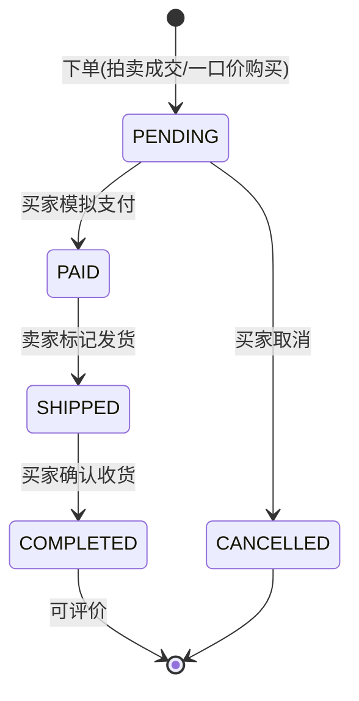

#### 4.5.2 功能详细

**① 创建订单（M5-F01）**

- 输入：productId（一口价购买时由买家触发；拍卖成交时由M3调用）
- 处理：查询商品信息（从products表取fixed_price或current_price作为amount）→ 创建Order（status=PENDING, buyer_id=当前用户, seller_id=商品卖家）→ 更新商品status='SOLD'
- 输出：OrderVO
- 权限：USER(买家) 或 系统（M3调用）

**② 模拟支付（M5-F02）**

- 输入：orderId
- 处理：校验status=PENDING → 校验操作者为买家本人 → UPDATE status='PAID', paid_at=NOW()
- 输出：OrderVO（含更新后状态）
- 权限：USER(买家本人)

**③ 标记发货（M5-F03）**

- 输入：orderId
- 处理：校验status=PAID → 校验操作者为卖家本人 → UPDATE status='SHIPPED', shipped_at=NOW()
- 输出：OrderVO
- 权限：USER(卖家本人)

**④ 确认收货（M5-F04）**

- 输入：orderId
- 处理：校验status=SHIPPED → 校验操作者为买家本人 → UPDATE status='COMPLETED', completed_at=NOW()
- 输出：OrderVO + 触发评价入口
- 权限：USER(买家本人)

**⑤ 取消订单（M5-F05）**

- 输入：orderId
- 处理：校验status=PENDING → 校验操作者为买家本人 → UPDATE status='CANCELLED' → UPDATE products SET status='ACTIVE'（恢复商品可售）
- 输出：OrderVO
- 权限：USER(买家本人)

**⑥ 订单列表（M5-F06）**

- 输入：状态筛选, page, size
- 处理：按角色查询（买家查buyer_id=?，卖家查seller_id=?）→ 关联商品信息
- 输出：Page<OrderVO>
- 权限：USER

#### 4.5.3 相关功能

| 组件名 | 说明 | 关系 |
|--------|------|------|
| M2 商品管理 | 商品信息 | 读取商品信息（amount/seller_id）；更新商品状态（SOLD/ACTIVE） |
| M3 拍卖引擎 | 拍卖成交 | 拍卖成交后M3调用createOrder() |
| M6 信誉评价 | 评价系统 | 订单COMPLETED后双方可评价 |

#### 4.5.4 用户接口

| 接口 | 方法 | 说明 |
|------|:--:|------|
| `/api/v1/orders` | GET | 订单列表（?status=PENDING&role=buyer） |
| `/api/v1/orders` | POST | 创建订单（一口价购买） |
| `/api/v1/orders/{id}` | GET | 订单详情（仅参与方可查看） |
| `/api/v1/orders/{id}/pay` | POST | 模拟支付（仅买家） |
| `/api/v1/orders/{id}/ship` | POST | 标记发货（仅卖家） |
| `/api/v1/orders/{id}/confirm` | POST | 确认收货（仅买家） |
| `/api/v1/orders/{id}/cancel` | POST | 取消订单（仅买家，仅PENDING状态） |

> **图4-10 订单模块类图**

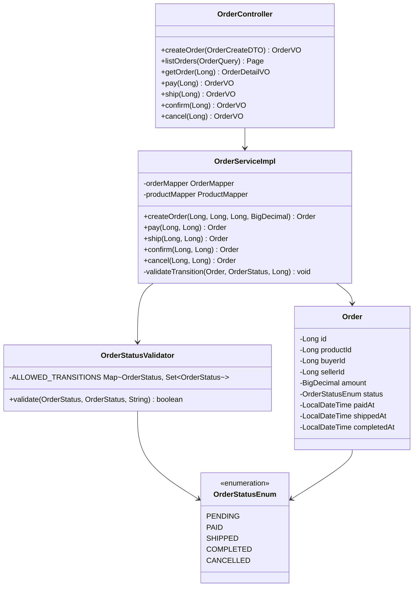

---

### 4.6 管理后台与统计功能 (M6)

#### 4.6.1 功能概要

提供管理员专用后台功能：用户身份审核与封禁管理、商品审核与下架管理、分类标签管理、拍卖异常监控、平台数据统计看板（ECharts可视化）。所有管理接口统一标注 `@PreAuthorize("hasRole('ADMIN')")`。

#### 4.6.2 功能详细

**① 用户列表与审核（M6-F01/F02）**

- 输入：page, size, status筛选, keyword搜索
- 处理：分页查询users表 → 支持按status(PENDING/ACTIVE/BANNED)和keyword(模糊匹配student_id/username)筛选 → 审核通过：UPDATE status='ACTIVE' + 通知用户；审核驳回：通知用户"身份审核未通过"
- 输出：Page<UserVO>
- 权限：ADMIN

**② 封禁/解封用户（M6-F03）**

- 输入：userId, 操作类型(BAN/UNBAN)
- 处理：封禁：status='BANNED'；解封：status='ACTIVE'
- 输出：成功消息
- 权限：ADMIN

**③ 商品审核（M6-F04/F05）**

- 输入：page, status筛选
- 处理：分页查询products表（优先PENDING状态）→ 审核通过：status='ACTIVE'；下架：status='BANNED'
- 输出：Page<ProductVO>
- 权限：ADMIN

**④ 分类管理（M6-F06）**

- 输入：CRUD操作（name, icon, parent_id）
- 处理：增删改查categories表（树形结构，parent_id关联实现无限层级）
- 输出：全部分类列表（树形JSON）
- 权限：ADMIN

**⑤ 数据概览（M6-F07）**

- 输入：无
- 处理：聚合查询 — COUNT(users)总用户数、COUNT(products)总商品数、COUNT(orders WHERE DATE(created_at)=TODAY)今日订单数、SUM(amount WHERE DATE(created_at)=TODAY)今日成交额、COUNT(products WHERE type='AUCTION' AND status='SOLD')/COUNT(products WHERE type='AUCTION')拍卖成交率
- 输出：StatsOverviewVO
- 权限：ADMIN

**⑥ 趋势数据（M6-F08）**

- 输入：days（7或30天）
- 处理：查询近N天每日新增用户数/新增订单数/成交额，按日期分组 → 返回二维数组供ECharts渲染折线图
- 输出：List<TrendDataVO> [{date, newUsers, newOrders, totalAmount}]
- 权限：ADMIN

#### 4.6.3 相关功能

| 组件名 | 说明 | 关系 |
|--------|------|------|
| M1 用户认证 | 用户管理与权限 | ADMIN角色校验；封禁后用户Token立即失效 |
| M2 商品管理 | 商品审核 | 审核通过/下架商品 |
| M3 拍卖引擎 | 拍卖监管 | 查看进行中拍卖、异常出价监控 |
| M5 订单交易 | 交易统计 | 聚合订单数据生成统计图表 |

#### 4.6.4 用户接口

| 接口 | 方法 | 权限 | 说明 |
|------|:--:|:--:|------|
| `/api/v1/admin/users` | GET | ADMIN | 用户列表（分页+搜索+状态筛选） |
| `/api/v1/admin/users/{id}/verify` | PUT | ADMIN | 身份审核 |
| `/api/v1/admin/users/{id}/ban` | PUT | ADMIN | 封禁/解封 |
| `/api/v1/admin/products` | GET | ADMIN | 商品列表（含审核筛选） |
| `/api/v1/admin/products/{id}/audit` | PUT | ADMIN | 商品审核/下架 |
| `/api/v1/admin/categories` | GET/POST/PUT/DELETE | ADMIN | 分类管理 |
| `/api/v1/admin/stats/overview` | GET | ADMIN | 数据概览 |
| `/api/v1/admin/stats/trend` | GET | ADMIN | 趋势数据（?days=7） |

> **图4-11 管理后台模块类图**

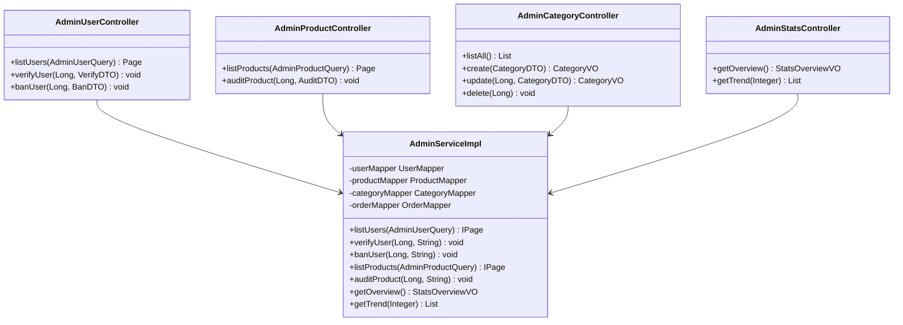

---

## 5. 非功能需求

### 5.1 权限需求

| 权限级别 | 角色标识 | 说明 | 包含权限 |
|---------|:--:|------|---------|
| 未登录 | ANONYMOUS | 未登录访客 | 浏览商品列表、查看商品详情、搜索商品、查看用户公开主页 |
| 普通用户 | USER | 已认证普通用户（买家/卖家） | 以上全部 + 发布商品、出价、IM聊天、下单支付、确认收货、评价交易、管理个人信息 |
| 管理员 | ADMIN | 平台运营维护者 | 以上全部 + 用户管理(审核/封禁)、商品管理(审核/下架)、分类管理、拍卖监管、数据统计 |

**实现方式**：Spring Security + JWT + `@PreAuthorize`注解。角色存储于users表的role字段。Service层通过SecurityContextHolder.getContext()获取当前用户进行数据归属校验。

### 5.2 兼容互换性

- **浏览器兼容**：桌面端 Chrome 120+ / Edge 120+ / Firefox 120+；移动端 iOS Safari 16+ / Android Chrome 120+
- **API版本兼容**：使用 `/api/v1/` 路径前缀，后续版本 `/api/v2/` 可与v1并行运行
- **数据库兼容**：标准MySQL 8.0 SQL，可迁移至MariaDB 10.6+或云数据库RDS(MySQL版)
- **容器兼容**：Docker Compose编排，任何支持Docker的Linux/Windows/macOS环境均可运行
- **图片格式兼容**：JPEG、PNG、GIF、WebP

### 5.3 安全性

| 安全措施 | 实现方式 |
|---------|---------|
| 密码加密 | BCryptPasswordEncoder（强度10），不可逆 |
| 身份认证 | JWT HMAC-SHA256签名，密钥≥256位。AccessToken 30分钟，RefreshToken 7天 |
| 接口授权 | @PreAuthorize注解 + 自定义权限表达式。Service层校验数据归属（如：用户只能取消自己的订单） |
| SQL注入防护 | MyBatis-Plus `#{}`参数化查询（100%防注入），严禁使用 `${}` |
| XSS防护 | 输入：Spring HtmlUtils.htmlEscape()过滤；输出：Vue自动转义 |
| CSRF | 前后端分离（Token认证而非Cookie认证），天然免疫 |
| 文件上传安全 | 类型白名单(jpg/png/gif/webp)、大小≤5MB、UUID随机文件名、禁止可执行扩展名 |
| CORS | 仅允许前端域名白名单 + localhost:5173 |
| IM内容审核 | 本地敏感词词库（sensitive_words表），系统启动时加载到内存HashSet，匹配拦截替换为`***` |
| 端口隔离 | Docker仅暴露80/443（Nginx），MySQL:3306和Redis:6379仅容器内网访问 |

### 5.4 健壮性

| 措施 | 说明 |
|------|------|
| 统一异常处理 | @RestControllerAdvice + @ExceptionHandler，所有未捕获异常返回 `{code, message, timestamp}` 统一格式 |
| 输入校验 | 前端Element Plus表单验证（失焦+提交双触发）；后端Spring Validation（@Valid/@NotBlank/@Size/@Min/@Max） |
| WebSocket断连重连 | 前端SockJS+STOMP，指数退避 1s→2s→4s→8s→16s→最大30s |
| 数据库连接池 | HikariCP，最大连接数20，最小空闲5，连接超时30s，泄漏检测60s |
| 优雅关闭 | server.shutdown=graceful，等待进行中请求完成（最多30秒） |
| 定时任务幂等 | @Scheduled拍卖判定使用Redis分布式锁（SETNX auction:check:lock NX EX 60） |
| 文件上传异常隔离 | 单张图片上传失败不影响同批次其他图片 |

### 5.5 使用性（操作性）

| 措施 | 说明 |
|------|------|
| 响应式布局 | CSS Flexbox/Grid，适配1920px桌面至375px手机 |
| 加载状态 | 骨架屏（首页商品列表）、Loading Spinner（按钮）、进度条（图片上传） |
| 操作反馈 | ElMessage Toast：成功绿色 / 警告橙色 / 错误红色，3秒自动消失 |
| 防重复提交 | 出价按钮出价中锁定1秒；下单按钮变"处理中..." |
| 空状态 | 列表无数据显示插画+"暂无数据"文字 |
| 返回顶部 | 滚动超过一屏显示"↑回到顶部"浮动按钮 |
| 草稿保存 | 发布商品表单内容localStorage暂存，防误关丢失 |
| 快捷键 | 聊天窗口 Enter发送、Shift+Enter换行 |

### 5.6 效率性（性能）

| 指标 | 目标值 | 实现策略 |
|------|:--:|---------|
| 核心API P50延迟 | < 200ms | HikariCP连接池 + MySQL索引覆盖高频查询 |
| 核心API P99延迟 | < 500ms | Redis缓存热点数据（商品列表5min、用户信息10min） |
| 拍卖出价推送延迟 | < 500ms | Redis Lua原子(<1ms) + STOMP直推（无中间MQ） |
| 商品搜索响应 | < 300ms | MySQL ngram全文索引 + LIKE降级 |
| 并发用户数 | ≥ 200 | Tomcat max-threads=200；无状态设计支持水平扩展 |
| 系统吞吐量 | ≥ 300 TPS | 拍卖出价异步持久化(@Async)不阻塞主线程 |

**数据库索引清单：**

```sql
-- 商品
CREATE INDEX idx_products_status_created ON products(status, created_at DESC);
CREATE FULLTEXT INDEX ft_products_search ON products(title, description) WITH PARSER ngram;
-- 拍卖
CREATE INDEX idx_bids_product_time ON bids(product_id, bid_time DESC);
-- IM
CREATE INDEX idx_messages_conv_time ON messages(conversation_id, created_at);
-- 订单
CREATE INDEX idx_orders_buyer_status ON orders(buyer_id, status);
CREATE INDEX idx_orders_seller_status ON orders(seller_id, status);
-- 通知
CREATE INDEX idx_notif_user_read ON notifications(user_id, is_read, created_at DESC);
```

### 5.7 维护性

| 措施 | 说明 |
|------|------|
| 代码规范 | 后端 阿里巴巴Java开发手册；前端 Vue 3官方风格指南 + ESLint + Prettier |
| 日志 | SLF4J+Logback。INFO：登录/出价/下单/支付；WARN：业务异常；ERROR：系统异常含堆栈 |
| 数据库迁移 | Flyway版本化，脚本命名 `V{版本号}__{描述}.sql` |
| API文档 | SpringDoc OpenAPI自动生成，`http://localhost:8080/swagger-ui.html` |
| 模块解耦 | 6个模块按功能分包，模块间通过Service接口调用 |
| 代码注释 | 所有public方法Javadoc；复杂逻辑（拍卖Lua脚本）详细行内注释 |

### 5.8 移植性

- Docker Compose编排全部服务，`docker-compose up -d` 即可在任意Linux服务器运行
- 不依赖特定云平台（阿里云/腾讯云/华为云/AWS均可）
- 标准MySQL 8.0 SQL，可迁至MariaDB 10.6+或云RDS
- 图片存储可切换：`FileStorageService`接口抽象，默认本地文件系统，可换OSS/MinIO

### 5.9 用户文档

- README.md — 环境要求、启动步骤、Docker部署、项目结构
- Swagger API文档 — 全部接口描述+在线调试（`http://localhost:8080/swagger-ui.html`）
- 项目总结PPT — 演示用

### 5.10 其他

无额外非功能需求。

---

## 6. 使用和操作方法

### 6.1 环境设定

**【本地开发环境搭建】**

**Step 1 — 启动基础设施：**

```bash
cd campus-auction/deploy
docker-compose up -d mysql redis
```

**Step 2 — 启动后端（Flyway首次启动自动建表）：**

```bash
cd campus-auction/backend
./mvnw spring-boot:run
# 验证: http://localhost:8080/swagger-ui.html
```

**Step 3 — 启动前端：**

```bash
cd campus-auction/frontend
npm install
npm run dev
# 验证: http://localhost:5173
```

**【生产环境一键部署】**

```bash
cd campus-auction/deploy
docker-compose up -d --build
# 启动顺序: MySQL → Redis → Spring Boot → Nginx
```

### 6.2 使用方法

**【核心用户旅程】**

**1. 注册与登录**：访问首页 → 右上角"注册" → 填写学号/邮箱/密码/手机号 → 提交 → "注册成功，等待审核" → 管理员后台审核通过 → 登录 → 获得JWT → 进入首页

**2. 浏览与搜索商品**：首页Feed流浏览 → 点击分类标签筛选 → 搜索框输入关键词（如"教材"）→ 搜索结果页按价格/时间排序 → 点击商品卡片进入详情页

**3. 发布商品**：点击"发布" → 填写标题描述 → 拖拽上传图片 → 选择分类 → 选择交易模式（一口价填价格 / 拍卖填起拍价+时长）→ 提交 → 审核通过后公开展示

**4. 参与拍卖**：进入拍卖商品详情页 → 查看当前最高价和出价记录 → 输入出价金额 → 点击"出价"→ 成功则页面实时更新（如被超越会看到WebSocket推送）→ 倒计时归零 → 系统判定得主

**5. IM私聊**：商品详情页"联系卖家"→ 进入聊天窗口 → 输入文字（Enter发送，Shift+Enter换行）→ 消息实时送达 → 可发送商品实物图

**6. 订单与评价**：拍卖成交/购买后 → "我的订单"→ 点击"模拟支付"→ 卖家发货后→"确认收货"→ 弹出评价窗口→ 打分+文字→提交→双方信誉分更新

**7. 管理后台**：管理员登录 → "管理后台"入口 → 仪表盘概览 → "用户管理"审核新用户 → "商品管理"审核商品 → "数据统计"查看趋势图表

---

## 7. 注意限制事项

### 7.1 制约／限制事项

| 限制项 | 说明 |
|--------|------|
| 支付限制 | 使用模拟支付（点击按钮即视为支付成功），不接入微信支付、支付宝等真实支付网关 |
| 通知限制 | 使用站内通知（notifications表+WebSocket）代替短信和邮件 |
| 存储限制 | 开发/演示阶段使用本地文件系统（uploads/目录），生产建议切换OSS/MinIO |
| 移动端限制 | 仅Web响应式适配（浏览器访问），不提供iOS/Android原生App |
| 推荐限制 | 使用"热门排行"简单排序（浏览量+收藏数+成交数加权），不实现推荐算法 |
| 认证限制 | 学号+管理员人工审核，不接入学校SSO/CAS统一认证 |
| 时间基准 | 拍卖以服务器时间判定到期，前端倒计时仅展示用，网络延迟可能导致显示差异 |
| 并发限制 | 设计支持200并发，超此规模需增加负载均衡和数据库读写分离 |
| IM限制 | 仅支持文字和图片消息，不支持视频/文件/语音 |
| 商品分页 | 列表分页固定20条/页 |

### 7.2 假定事项

1. 用户通过学号/工号注册即视为校园身份有效，管理员审核过后账号激活
2. 服务器运行在稳定网络环境（可用性≥99.5%，带宽≥100Mbps）
3. 并发用户量在200以内（课程演示规模）
4. 用户浏览器支持WebSocket（Chrome/Edge/Firefox 120+均支持）
5. 服务器磁盘≥40GB（商品图片存储）
6. 数据量在10万条以内时MySQL单实例满足性能需求
7. 服务器系统时间与NTP同步，误差<1秒
8. 以单实例Docker部署（非集群），拍卖定时任务通过Redis锁防多实例并发

### 7.3 特记事项

1. **拍卖时间以服务器为准**：前端倒计时以`auction_end - serverNow`为基准，首次加载从服务器获取当前时间戳校准
2. **拍卖成交不可逆**：成交后自动生成订单，买卖双方不可取消（与一口价订单不同）
3. **出价防抖**：同一用户3秒内对同一商品多次出价，仅接受最后一次（前端锁1秒+后端时间窗口去重）
4. **敏感词过滤使用本地词库**：sensitive_words表，启动时加载到内存，不调第三方API
5. **信誉分=100+好评×1-差评×2**，最低0分。信誉分<60限制发布商品
6. **订单默认好评**：完成后7天未评价，系统自动生成5星好评
7. **IM会话限制**：每用户最多10个活跃会话
8. **用户举报**：核实3次自动封禁7天

---

## 8. 附录

### 8.1 业务规则

| 编号 | 规则描述 |
|:--:|---------|
| BR-01 | 出价金额必须大于当前最高价，最小加价幅度1元 |
| BR-02 | 拍卖到期，最高出价者得；无出价则流拍（status=EXPIRED） |
| BR-03 | 一口价商品被购买后立即status=SOLD，不再展示 |
| BR-04 | 订单仅在PENDING状态可由买家取消；PAID后不可取消 |
| BR-05 | 交易完成后7天内双方可评价，超期默认好评 |
| BR-06 | 信誉分=100+好评×1-差评×2，<60限制发布商品 |
| BR-07 | 同一用户3秒内同一商品多次出价，仅记录最后一次 |
| BR-08 | 每用户最多10个IM会话 |
| BR-09 | 新用户首次发布商品须管理员审核；信誉分≥80免审 |
| BR-10 | 用户被举报核实3次，自动封禁7天 |

### 8.2 术语表

| 术语 | 定义 |
|------|------|
| CAIP | Campus Auction & IM Platform，本系统英文简称 |
| 英式拍卖（English Auction） | 出价从低到高的升价拍卖，在截止时间内价高者得 |
| 一口价（Fixed Price） | 卖家设定固定价格，买家直接购买，无需竞价 |
| 流拍（Auction Expired） | 拍卖结束时无人出价，商品状态变为EXPIRED |
| STOMP | Simple Text Oriented Messaging Protocol，面向文本的消息协议，运行于WebSocket之上，支持发布订阅(Topic)和点对点(Queue) |
| JWT（JSON Web Token） | 无状态认证令牌，包含用户ID、角色、过期时间，使用HMAC-SHA256签名 |
| MyBatis-Plus | Java持久层框架，提供Lambda表达式查询、自动分页、代码生成器 |
| Flyway | 数据库版本迁移工具，通过SQL脚本管理数据库Schema变更 |
| DFD（Data Flow Diagram） | 数据流图，描述系统中数据的流动方向和处理逻辑 |
| RBAC（Role-Based Access Control） | 基于角色的访问控制，通过角色控制用户权限 |
| HikariCP | 高性能JDBC数据库连接池 |
| 软删除 | 标记deleted_at字段而非物理删除数据 |
| 信誉分 | 用户交易信用的量化指标，100+好评×1-差评×2 |

### 8.3 数据流图

> **图8-1 顶层数据流图 DFD Level 0**

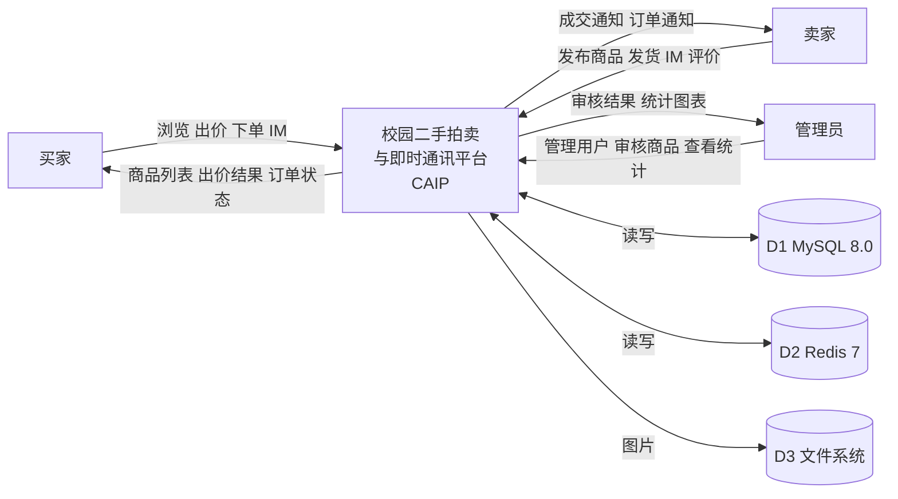

> **图8-2 一级数据流图 DFD Level 1**

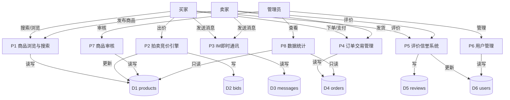

### 8.4 数据字典

> **图8-3 数据库ER图**

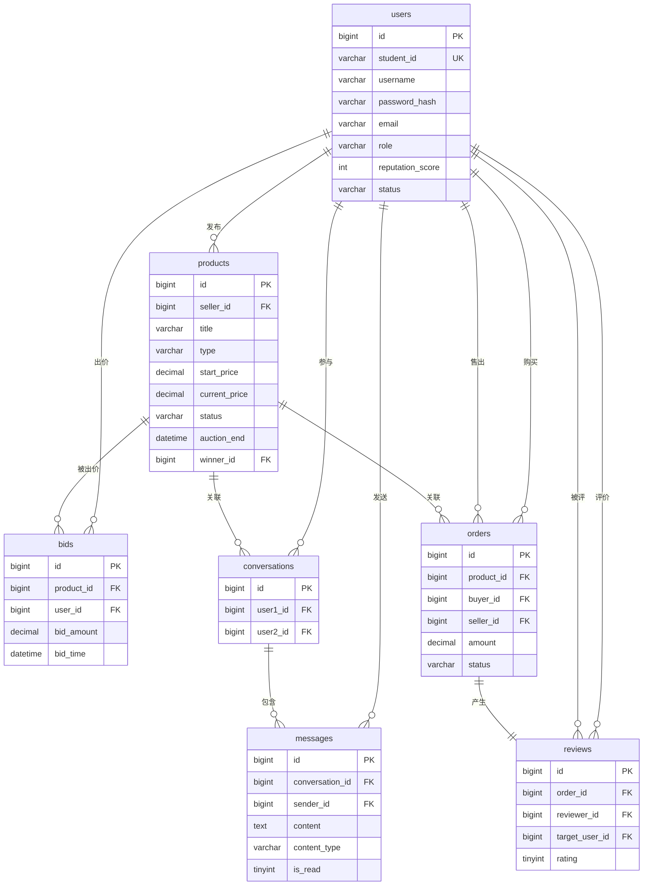

#### 8.4.1 各表详细字段定义

**(1) users 用户表**

| 字段 | 类型 | 约束 | 说明 |
|------|------|------|------|
| id | BIGINT | PK, AUTO_INCREMENT | 主键 |
| student_id | VARCHAR(20) | UNIQUE, NOT NULL | 学号/工号 |
| username | VARCHAR(50) | NOT NULL | 用户名（昵称） |
| password_hash | VARCHAR(255) | NOT NULL | BCrypt加密密码 |
| email | VARCHAR(100) | NOT NULL | 邮箱 |
| phone | VARCHAR(20) | NULL | 手机号 |
| avatar | VARCHAR(500) | NULL | 头像URL |
| role | VARCHAR(20) | NOT NULL, DEFAULT 'USER' | USER / ADMIN |
| reputation_score | INT | DEFAULT 100 | 信誉分 |
| status | VARCHAR(20) | NOT NULL, DEFAULT 'PENDING' | ACTIVE / BANNED / PENDING |
| created_at | DATETIME | NOT NULL, DEFAULT NOW() | 创建时间 |
| updated_at | DATETIME | NOT NULL, DEFAULT NOW() ON UPDATE NOW() | 更新时间 |

索引：uk_users_student_id UNIQUE(student_id), idx_users_status(status)

**(2) products 商品表**

| 字段 | 类型 | 约束 | 说明 |
|------|------|------|------|
| id | BIGINT | PK, AUTO_INCREMENT | 主键 |
| seller_id | BIGINT | FK→users.id, NOT NULL | 卖家ID |
| title | VARCHAR(200) | NOT NULL | 标题 |
| description | TEXT | NULL | 描述 |
| category_id | INT | FK→categories.id, NULL | 分类ID |
| type | VARCHAR(10) | NOT NULL | SALE（一口价） / AUCTION（拍卖） |
| start_price | DECIMAL(10,2) | NULL | 起拍价（AUCTION） |
| fixed_price | DECIMAL(10,2) | NULL | 一口价（SALE） |
| current_price | DECIMAL(10,2) | NULL | 当前最高价（AUCTION） |
| status | VARCHAR(20) | NOT NULL, DEFAULT 'ACTIVE' | ACTIVE / SOLD / EXPIRED / BANNED / PENDING |
| auction_start | DATETIME | NULL | 拍卖开始时间 |
| auction_end | DATETIME | NULL | 拍卖结束时间 |
| winner_id | BIGINT | FK→users.id, NULL | 得主ID |
| view_count | INT | DEFAULT 0 | 浏览次数 |
| created_at | DATETIME | NOT NULL | 创建时间 |
| updated_at | DATETIME | NOT NULL | 更新时间 |

索引：idx_products_status_created(status, created_at DESC), idx_products_category(category_id), idx_products_seller(seller_id), FULLTEXT ft_products_search(title, description) WITH PARSER ngram

**(3) product_images 商品图片表**

| 字段 | 类型 | 约束 | 说明 |
|------|------|------|------|
| id | BIGINT | PK, AUTO_INCREMENT | 主键 |
| product_id | BIGINT | FK→products.id, NOT NULL | 商品ID |
| image_url | VARCHAR(500) | NOT NULL | 图片URL |
| sort_order | INT | DEFAULT 0 | 排序 |

**(4) categories 分类表**

| 字段 | 类型 | 约束 | 说明 |
|------|------|------|------|
| id | INT | PK, AUTO_INCREMENT | 主键 |
| name | VARCHAR(50) | NOT NULL | 分类名 |
| icon | VARCHAR(100) | NULL | 图标 |
| parent_id | INT | NULL | 父分类ID（NULL=顶级，树形结构） |

**(5) product_favorites 收藏表**

| 字段 | 类型 | 约束 | 说明 |
|------|------|------|------|
| id | BIGINT | PK, AUTO_INCREMENT | 主键 |
| user_id | BIGINT | FK→users.id, NOT NULL | 用户ID |
| product_id | BIGINT | FK→products.id, NOT NULL | 商品ID |
| created_at | DATETIME | NOT NULL | 收藏时间 |

索引：uk_fav_user_product UNIQUE(user_id, product_id)

**(6) bids 出价记录表**

| 字段 | 类型 | 约束 | 说明 |
|------|------|------|------|
| id | BIGINT | PK, AUTO_INCREMENT | 主键 |
| product_id | BIGINT | FK→products.id, NOT NULL | 商品ID |
| user_id | BIGINT | FK→users.id, NOT NULL | 出价人ID |
| bid_amount | DECIMAL(10,2) | NOT NULL | 出价金额 |
| bid_time | DATETIME | NOT NULL | 出价时间 |

索引：idx_bids_product_time(product_id, bid_time DESC), uk_bids_product_user UNIQUE(product_id, user_id, bid_amount)

**(7) conversations 会话表**

| 字段 | 类型 | 约束 | 说明 |
|------|------|------|------|
| id | BIGINT | PK, AUTO_INCREMENT | 主键 |
| user1_id | BIGINT | FK→users.id, NOT NULL | 参与方1（较小ID） |
| user2_id | BIGINT | FK→users.id, NOT NULL | 参与方2（较大ID） |
| product_id | BIGINT | FK→products.id, NULL | 关联商品 |
| last_message_at | DATETIME | NULL | 最后消息时间 |
| created_at | DATETIME | NOT NULL | 创建时间 |

索引：uk_conv_users_product UNIQUE(user1_id, user2_id, product_id)

**(8) messages 消息表**

| 字段 | 类型 | 约束 | 说明 |
|------|------|------|------|
| id | BIGINT | PK, AUTO_INCREMENT | 主键 |
| conversation_id | BIGINT | FK→conversations.id, NOT NULL | 会话ID |
| sender_id | BIGINT | FK→users.id, NOT NULL | 发送者 |
| content | TEXT | NOT NULL | 内容（文字或图片URL） |
| content_type | VARCHAR(10) | DEFAULT 'TEXT' | TEXT / IMAGE |
| is_read | TINYINT(1) | DEFAULT 0 | 0未读/1已读 |
| created_at | DATETIME | NOT NULL | 发送时间 |

索引：idx_msg_conv_time(conversation_id, created_at)

**(9) orders 订单表**

| 字段 | 类型 | 约束 | 说明 |
|------|------|------|------|
| id | BIGINT | PK, AUTO_INCREMENT | 主键 |
| product_id | BIGINT | FK→products.id, NOT NULL | 商品ID |
| buyer_id | BIGINT | FK→users.id, NOT NULL | 买家ID |
| seller_id | BIGINT | FK→users.id, NOT NULL | 卖家ID |
| amount | DECIMAL(10,2) | NOT NULL | 成交金额 |
| status | VARCHAR(20) | NOT NULL, DEFAULT 'PENDING' | PENDING / PAID / SHIPPED / COMPLETED / CANCELLED |
| created_at | DATETIME | NOT NULL | 下单时间 |
| paid_at | DATETIME | NULL | 支付时间 |
| shipped_at | DATETIME | NULL | 发货时间 |
| completed_at | DATETIME | NULL | 完成时间 |

索引：idx_orders_buyer_status(buyer_id, status), idx_orders_seller_status(seller_id, status), idx_orders_product(product_id)

**(10) reviews 评价表**

| 字段 | 类型 | 约束 | 说明 |
|------|------|------|------|
| id | BIGINT | PK, AUTO_INCREMENT | 主键 |
| order_id | BIGINT | FK→orders.id, UNIQUE, NOT NULL | 订单ID（一个订单一条评价） |
| reviewer_id | BIGINT | FK→users.id, NOT NULL | 评价者 |
| target_user_id | BIGINT | FK→users.id, NOT NULL | 被评价者 |
| rating | TINYINT | NOT NULL, CHECK(1-5) | 评分（1-5星） |
| content | VARCHAR(500) | NULL | 评价内容 |
| created_at | DATETIME | NOT NULL | 评价时间 |

**(11) notifications 通知表**

| 字段 | 类型 | 约束 | 说明 |
|------|------|------|------|
| id | BIGINT | PK, AUTO_INCREMENT | 主键 |
| user_id | BIGINT | FK→users.id, NOT NULL | 接收者 |
| type | VARCHAR(30) | NOT NULL | 类型（AUCTION_WON / NEW_MESSAGE / ORDER_UPDATE ...） |
| title | VARCHAR(100) | NOT NULL | 标题 |
| content | VARCHAR(500) | NULL | 内容 |
| is_read | TINYINT(1) | DEFAULT 0 | 已读标记 |
| related_id | BIGINT | NULL | 关联对象ID |
| created_at | DATETIME | NOT NULL | 通知时间 |

索引：idx_notif_user_read(user_id, is_read, created_at DESC)

---

